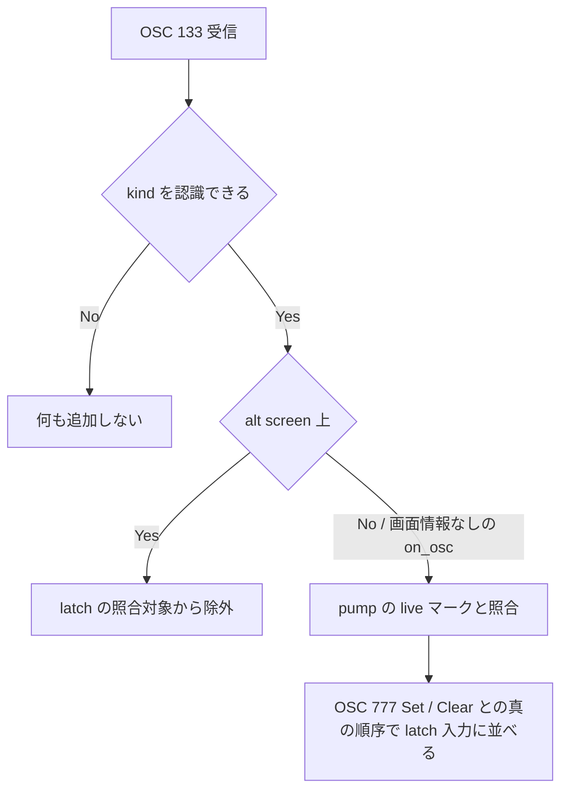

# agent-latch-alt-screen-prompt-mark - 要件定義書

## 1. 概要

### 1.1 背景

1 つの処理単位に、alt screen 上の OSC 133 マーク、alt screen からの復帰、OSC 777 の agent-status 報告（Set / Clear）、main screen 上の OSC 133 マークが含まれる場合を対象とする。

alt screen 上のマークの kind が後続の main screen 上のマークの kind と一致する形（両画面で D → A）では、kind だけで照合する walk がマークの割り当てを誤る。

### 1.2 目的

上記の処理単位で、プレーンタブの推定クリア latch が main screen 上のマークを OSC 777 報告との真の順序どおりに受け取り、alt screen 上のマークを照合に使わないようにする。

### 1.3 スコープ

- 対象: プレーンタブの latch 経路。`callbacks.rs` の OSC 133 分岐（`handle_semantic_prompt`）が `LatchFeedEvent` 候補を供給する経路と、`reconcile_latch_feed`。
- 対象外: mux daemon 側。
- 対象外: 同じ処理単位内で RIS より前に捕捉された候補（latch feed には、OSC 7501 feed と異なり reset 項目が無い）。

## 2. ビジネス要件

### 2.1 ビジネス目標

1 つの処理単位に alt screen 上の OSC 133 マーク、alt screen からの復帰、OSC 777 agent-status 報告（Set / Clear）、main screen 上の OSC 133 マークが含まれるとき、プレーンタブの推定クリア latch が main screen 上のマークを報告に対する真の順序で受け取り、alt screen 上のマークを照合に使わない。

### 2.2 対象ユーザー

| ユーザータイプ | 説明 |
|----------------|------|
| 該当なし | — |

### 2.3 期待される効果

- 該当なし

## 3. ユースケース

### 3.1 ユースケース一覧

| ID | ユースケース名 | アクター | 優先度 |
|----|----------------|----------|--------|
| UC01 | alt screen のマークと main screen のマークを含む処理単位を latch に渡す | プレーンタブの出力処理 | — |

### 3.2 ユースケース詳細

#### UC01: alt screen のマークと main screen のマークを含む処理単位を latch に渡す

**アクター**: プレーンタブの出力処理

**事前条件**:
- プレーンタブ（mux 非接続）である。

**基本フロー**:
1. 1 回の `process_combined` 呼び出しに、alt screen への切り替え、alt screen 上の OSC 133 D / A、alt screen からの復帰、OSC 777 Set、main screen 上の OSC 133 D / A が含まれる。
2. alt screen 上の OSC 133 候補を latch の照合対象から除外する。
3. main screen 上のマークを、OSC 777 Set / Clear との真の順序で latch 入力に並べる。
4. latch 入力 [Set, Mark(CommandEnd), Mark(PromptStart)] を Set イベントとともに適用する。

**代替フロー**:
- Set と main screen の A の間に Clear がある: latch 入力は [Set, Mark(CommandEnd), Clear, Mark(PromptStart)]。
- Set と main screen の A の間に 2 回目の Set がある: latch 入力は [Set, Mark(CommandEnd), Set, Mark(PromptStart)]。

**事後条件**:
- タブのステータスがクリアされている（基本フロー）。

## 4. 機能要件

### 4.1 機能一覧

| ID | 機能名 | 説明 | 優先度 |
|----|--------|------|--------|
| FR1 | alt screen の候補を latch の照合から除外する | alt screen 上で受け取った OSC 133 候補を、kind・順序に関係なく pump の live マークとの照合対象から外す | — |
| FR2 | main screen のマークを真の順序で latch に渡す | pump 内で live と確定した main screen の OSC 133 マークを、同じ pump の OSC 777 Set / Clear との相対順序どおりに latch に渡す | — |
| FR3 | 既存の振る舞いを維持する | latch の解除条件、明示 Clear、OSC 777 の位置、画面情報なし通知、未知 kind、mux 接続タブ、OSC 7501 feed の振る舞いを維持する | — |

### 4.2 機能詳細

#### FR1: alt screen の候補を latch の照合から除外する

**説明**: alt screen（`?47` / `?1047` / `?1049` で有効になる代替画面。term_core の `MODE_ALT_SCREEN` 判定）上で受け取った OSC 133 候補は、kind や順序に関係なく、agent-status latch のための pump の live マークとの照合に使わない。これらの候補は main screen の live マークを消費しない。

**入力**:
- OSC 133 候補: `TerminalCallbacks::on_osc_with_screen` が渡す、alt screen 判定（`alt_screen_active`）付きの通知

**出力**:
- latch 入力列: alt screen 上の候補を含まない

**処理フロー**:

**ビジネスルール**:
- alt screen の判定は term_core の `MODE_ALT_SCREEN` 判定（`?47` / `?1047` / `?1049` 共通）に従う。
- 認識できる kind（A / B / C / D）のすべてに同じ規則を適用する。

**バリデーション**:
| 項目 | ルール | エラーメッセージ |
|------|--------|------------------|
| 該当なし | — | — |

**エラーケース**:
| エラー | 条件 | 対応 |
|--------|------|------|
| 該当なし | — | — |

#### FR2: main screen のマークを真の順序で latch に渡す

**説明**: pump 内で live と確定した main screen の OSC 133 マークを、同じ pump の OSC 777 Set / Clear 報告に対する相対順序どおりに latch に渡す。同じ pump 内で同じ kind の alt screen マークが先行していても同様とする。

**入力**:
- 1 pump 分の latch feed（OSC 133 候補、OSC 777 Set / Clear）

**出力**:
- latch 入力列: main screen のマークと Set / Clear を真の順序で並べたもの

**ビジネスルール**:
- main screen の A が同じ処理単位内で alt screen のマークより前にある場合も、main screen のマークのみを順序どおりに latch に渡す。
- 複数の alt screen マークが main screen のマークより前にある場合も、main screen のマークのみを順序どおりに latch に渡す。

**バリデーション**:
| 項目 | ルール | エラーメッセージ |
|------|--------|------------------|
| 該当なし | — | — |

**エラーケース**:
| エラー | 条件 | 対応 |
|--------|------|------|
| 該当なし | — | — |

#### FR3: 既存の振る舞いを維持する

**説明**: 次の振る舞いを変えない。

- latch の解除条件: Set の後、live な main screen の D に続いて live な main screen の A が来ると、既存の Clear 経路で推定クリアを適用する。Set の後に D を伴わない A が来ても解除しない。
- 明示的な Clear は latch を解除（disarm）する。
- OSC 777 Set / Clear は元の位置のまま通過する。
- 画面情報なしの `on_osc` 通知で届いた OSC 133 は main screen として扱う。
- 認識できない OSC 133 の kind は何も追加しない。
- mux 接続タブの latch feed は破棄する。
- osc7501-alt-screen-prompt-mark による OSC 7501 feed の振る舞い。

**バリデーション**:
| 項目 | ルール | エラーメッセージ |
|------|--------|------------------|
| 該当なし | — | — |

**エラーケース**:
| エラー | 条件 | 対応 |
|--------|------|------|
| 該当なし | — | — |

## 5. 非機能要件

### 5.1 パフォーマンス要件

- NFR1 処理コスト: 1 pump 分の latch feed の照合は、feed の長さに比例する時間で終わり、ブロックせず、I/O を行わない。
- スループット: 該当なし
- 同時接続数: 該当なし

### 5.2 セキュリティ要件

- 該当なし

### 5.3 可用性要件

- 該当なし

### 5.4 保守性要件

- 該当なし

### 5.5 互換性要件

- NFR2 他経路の維持: mux 接続経路、OSC 7501 経路、OSC 133 以外のコールバックの振る舞いは、どちらの画面でも変わらない。

## 6. UI/UX要件

### 6.1 画面設計要件

UI や見た目の変更は無い。変更は agent-status latch のための OSC 133 候補の照合に限られる。

### 6.2 画面遷移

該当なし

### 6.3 レスポンシブ対応

該当なし

## 7. データ要件

### 7.1 データモデル概要

該当なし

### 7.2 データ項目

| エンティティ | 項目名 | 型 | 必須 | 説明 |
|--------------|--------|-----|------|------|
| 該当なし | — | — | — | — |

### 7.3 データ保持期間

| データ種別 | 保持期間 |
|------------|----------|
| 該当なし | — |

## 8. 外部連携

### 8.1 連携システム

| システム名 | 連携方法 | データ |
|------------|----------|--------|
| 該当なし | — | — |

### 8.2 API仕様要件

該当なし

## 9. 制約条件

### 9.1 技術的制約

- alt screen の検出は、`TerminalCallbacks::on_osc_with_screen` が渡す term_core の `MODE_ALT_SCREEN` 判定（`?47` / `?1047` / `?1049` 共通）を使う。osc7501-alt-screen-prompt-mark と同じ判定とする。
- 対象はプレーンタブの latch 経路（`callbacks.rs` の `handle_semantic_prompt` が `LatchFeedEvent` 候補を供給する経路と `reconcile_latch_feed`）。mux daemon 側は対象外。
- 同じ処理単位内で RIS より前に捕捉された候補は対象外。

### 9.2 ビジネス上の制約

- 該当なし

### 9.3 スケジュール制約

- 該当なし

### 9.4 宣言された変更集合

このフィーチャー固有のパスは手動で列挙せず、create-plan で `workflow.yaml` の各タスクの `files` から導出する（`references/phases/create-plan-phase.md`）。

**デフォルトメンバー**（SPEC作成者が明示的に除外しない限り、常に宣言に含まれる）:
- `feature-docs/agent-latch-alt-screen-prompt-mark/**`
- `test-docs/agent-latch-alt-screen-prompt-mark/**`

`feature-docs/agent-latch-alt-screen-prompt-mark/**` に含まれるもの: `REQUIREMENTS.md`、`SPEC.md`、`IMPLEMENTATION.md`、`workflow.yaml`、`phase-state/`、`tasks/`、`reviews/roundN.yaml`、`VERIFICATION.md`、`retrospect.yaml`、およびデザインステップが生成するデザイン成果物。生成主体は各フェーズドキュメントおよび `references/phase-state.md` を参照（引用のみ、ルールは再掲しない）。

`test-docs/agent-latch-alt-screen-prompt-mark/**` に含まれるもの: `{T}.tests.yaml`（パス形式: `test-docs/agent-latch-alt-screen-prompt-mark/{T}.tests.yaml`）。生成主体は `implement-phase.md` を参照（引用のみ、ルールは再掲しない）。

**意味論**:
- デフォルトのメンバーは、SPEC作成者が明示的に除外しない限り宣言に含まれる。除外は意図的な絞り込みであり、記載漏れによる省略ではない。
- この宣言はスーパーセット（superset）の主張であり、実際の変更集合は宣言に含まれる（CONTAINED IN）必要がある。実際には生成されないパスが宣言されていても違反にはならない。implementタスクを1つも生成しないフィーチャーは `test-docs/agent-latch-alt-screen-prompt-mark/` ディレクトリを生成しないが、宣言された `test-docs/agent-latch-alt-screen-prompt-mark/**` は依然として正しい。

## 10. 想定される課題とリスク

### 10.1 技術的課題

| 課題 | 影響度 | 対応策 |
|------|--------|--------|
| 該当なし | — | — |

### 10.2 ビジネスリスク

| リスク | 発生確率 | 影響度 | 対応策 |
|--------|----------|--------|--------|
| 該当なし | — | — | — |

## 11. 成功基準

### 11.1 受け入れ基準

- [ ] AC-1（FR1, FR2）: プレーンタブに `\x1b[?1049h\x1b]133;D;0\x07\x1b]133;A\x07\x1b[?1049l\x1b]777;emterm;agent-status;v=1;state=working\x07\x1b]133;D;0\x07\x1b]133;A\x07` を 1 回の `process_combined` 呼び出しで渡すと、latch 入力は [Set, Mark(CommandEnd), Mark(PromptStart)] になり、対応する Set イベントとともに適用するとタブのステータスはクリアされる。
- [ ] AC-2（FR1）: alt screen の切り替えに `?1047` または `?47` を使っても AC-1 と同じ結果になる。
- [ ] AC-3（FR1, FR2）: 間に Clear がある場合。Set、main screen の D、alt screen の A、復帰、Clear、main screen の A を含む 1 つの処理単位の latch 入力は [Set, Mark(CommandEnd), Clear, Mark(PromptStart)] になる。
- [ ] AC-4（FR1, FR2）: 間に Set がある場合。Set、main screen の D、alt screen の A、復帰、Set、main screen の A を含む 1 つの処理単位の latch 入力は [Set, Mark(CommandEnd), Set, Mark(PromptStart)] になる。
- [ ] AC-5（FR3, NFR2）: 既存の agent-exit-after-icon の latch テスト（ac1..ac7、`reconcile_latch_feed_*`）、osc7501 / program_status_feed のテスト、画面情報付きコールバックのテストが pass する。FR1 によって期待が反転するテストは名前を変え、その test-docs レコードを `.claude/rules/test-docs-records.md` に従って更新する。
- [ ] AC-6（FR1, FR2, FR3）: `CARGO_TARGET_DIR=src-tauri/target cargo test --manifest-path src-tauri/Cargo.toml --lib` がすべて pass し、`CARGO_TARGET_DIR=src-tauri/target cargo check --manifest-path src-tauri/Cargo.toml` と `CARGO_TARGET_DIR=src-tauri/target cargo check --manifest-path src-tauri/Cargo.toml --no-default-features` が pass する。

### 11.2 KPI

| 指標 | 目標値 | 測定方法 |
|------|--------|----------|
| 該当なし | — | — |

## 12. テストシナリオ

### 12.1 テスト観点

- [ ] 正常系: TS-1（FR1, FR2）AC-1 のバイト列でプレーンタブの latch 入力とクリア後の状態を確認する。
- [ ] 正常系: TS-2（FR1）`?1047` / `?47` で TS-1 と同じ結果になる。
- [ ] 正常系: TS-3（FR1, FR2）間に Clear がある処理単位の latch 入力を確認する。
- [ ] 正常系: TS-4（FR1, FR2）間に 2 回目の Set がある処理単位の latch 入力を確認する。
- [ ] 境界値: TS-5（FR1）コールバック単位で、`alt_screen_active=true` の OSC 133（A / B / C / D すべて）が照合に使われず、`alt_screen_active=false` と `on_osc` 経由では使われる。
- [ ] 境界値: TS-6（FR1, FR2）main screen の A が alt screen のマークより前にある場合と、複数の alt screen マークが main screen のマークより前にある場合に、main screen のマークのみが順序どおり latch に届く。
- [ ] 回帰: TS-7（FR3, NFR1, NFR2）既存の latch / osc7501 / program_status_feed / コールバックのテストを含む `--lib` スイート全体が pass する。
- [ ] セキュリティ: 該当なし
- [ ] パフォーマンス: NFR1 は TS-7 で扱う。

## 13. 用語定義

| 用語 | 定義 |
|------|------|
| alt screen | `?47` / `?1047` / `?1049` で有効になる代替画面。term_core の `MODE_ALT_SCREEN` 判定に従う |
| main screen | alt screen ではない通常画面。画面情報なしの `on_osc` 通知で届いた OSC 133 は main screen として扱う |
| 推定クリア latch | プレーンタブの agent-status latch。Set の後、live な main screen の D に続いて live な main screen の A が来ると、既存の Clear 経路で推定クリアを適用する |
| 処理単位 / pump | 1 回の `process_combined` 呼び出しで処理する出力のまとまり |
| live マーク | pump 内で live と確定した OSC 133 マーク |
| latch 入力 | latch に渡す Set / Clear / Mark(...) の列 |

## 14. 確認事項

### 14.1 確認済み事項

- 該当なし

### 14.2 未確認・保留事項

- 該当なし

### 14.3 前提

- [ ] A1（可逆）: latch の解除条件は変わらない。Set の後、live な main screen の D に続いて live な main screen の A で latch が解除され、Set の後の A 単独では解除されない（`agent_status_model/tests.rs` の `ac1_set_then_live_d_then_live_a_clears_via_existing_clear_path` と `ac2_set_then_live_a_without_d_leaves_state_unchanged` で固定されている）。このため、タスクの再現手順（alt screen の A、復帰、Set、main screen の A）は、Set と main screen の A の間に main screen の D があり、alt screen のマークの kind が main screen のマークと揃う形として読む。受け入れ基準はこの手順を使う。
- [ ] A2（可逆）: alt screen の検出には、`TerminalCallbacks::on_osc_with_screen` が渡す term_core の `MODE_ALT_SCREEN` 判定（`?47` / `?1047` / `?1049` 共通）を使う。osc7501-alt-screen-prompt-mark と同じ判定とする。
- [ ] A3（可逆）: 同じ処理単位内で RIS より前に捕捉された候補（latch feed には、OSC 7501 feed と異なり reset 項目が無い）は対象外とする。
- [ ] A4（可逆）: 対象はプレーンタブの latch 経路（`callbacks.rs` の OSC 133 分岐 `handle_semantic_prompt` が `LatchFeedEvent` 候補を供給する経路と `reconcile_latch_feed`）。mux daemon 側は対象外とする。

## 15. 参考資料

- `.claude/rules/test-docs-records.md`: テスト名変更時の test-docs レコード更新規則
- osc7501-alt-screen-prompt-mark: alt screen 判定と OSC 7501 feed の先行フィーチャー
