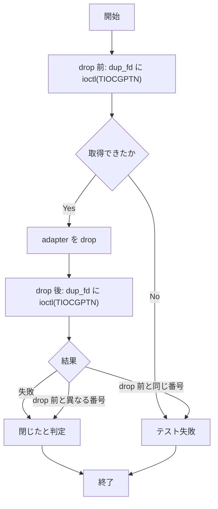

# inherited-pty-drop-fd-tiocgptn - 要件定義書

## 1. 概要

### 1.1 背景
`--lib` 全体の実行で `mux::inherited_pty::tests::dropping_the_adapter_closes_the_owned_descriptor` が間欠的に失敗する。先行 feature `inherited-pty-drop-fd-flake-investigation` で調査済み。

### 1.2 目的
- `--lib` 全体の実行で `mux::inherited_pty::tests::dropping_the_adapter_closes_the_owned_descriptor` が間欠的に失敗しない状態にし、無関係な変更の検証結果を読める状態に戻す
- drop 後の fd 番号が別の PTY master（またはその複製）に再利用されても、元の記述子が閉じたことを正しく判定する

### 1.3 スコープ
- 対象: `src-tauri/src/mux/inherited_pty.rs` のテストコード（`#[cfg(test)]` 内）と、`src-tauri/src/mux/upgrade/tests.rs:43` の参照コメント
- 対象外: `InheritedMasterPty` 本体と `Drop` の挙動

## 2. ビジネス要件

### 2.1 ビジネス目標
- `--lib` 全体の実行で `mux::inherited_pty::tests::dropping_the_adapter_closes_the_owned_descriptor` が間欠的に失敗しない状態にし、無関係な変更の検証結果を読める状態に戻す
- drop 後の fd 番号が別の PTY master（またはその複製）に再利用されても、元の記述子が閉じたことを正しく判定する

### 2.2 対象ユーザー
| ユーザータイプ | 説明 |
|----------------|------|
| 開発者 | `--lib` 全体のテストを実行して変更を検証する |

### 2.3 期待される効果
- `--lib` 全体の実行結果が対象テストの間欠失敗に左右されない
- 元の記述子が閉じたことの判定が、fd 番号の再利用に影響されない

## 3. ユースケース

### 3.1 ユースケース一覧
| ID | ユースケース名 | アクター | 優先度 |
|----|----------------|----------|--------|
| UC01 | `--lib` 全体のテストで変更を検証する | 開発者 | 高 |

### 3.2 ユースケース詳細

#### UC01: `--lib` 全体のテストで変更を検証する

**アクター**: 開発者

**事前条件**:
- `CARGO_TARGET_DIR=src-tauri/target cargo test --manifest-path src-tauri/Cargo.toml --lib` を実行できる

**基本フロー**:
1. 開発者が `--lib` 全体のテストを実行する
2. `dropping_the_adapter_closes_the_owned_descriptor` が TIOCGPTN による判定で成功する
3. 開発者が実行結果から変更の検証結果を読む

**代替フロー**:
- 対象テストが失敗した場合、失敗メッセージに fd 番号、drop 前の pts 番号、drop 後の `TIOCGPTN` の取得結果（pts 番号または errno）が出る

**事後条件**:
- 対象テストの結果が fd 番号の再利用に左右されない

## 4. 機能要件

### 4.1 機能一覧
| ID | 機能名 | 説明 | 優先度 |
|----|--------|------|--------|
| FR1 | 閉鎖判定の識別子を TIOCGPTN に置き換える | 対象テストの閉鎖判定を `st_rdev` 比較から `ioctl(TIOCGPTN)` による pts 番号の比較に置き換える | 高 |
| FR2 | 失敗メッセージに診断情報を含める | 対象テストの失敗メッセージに fd 番号、drop 前の pts 番号、drop 後の取得結果を含める | 高 |
| FR3 | 再発を検出するテスト | 閉鎖判定を決定的に検証するテストを追加する | 高 |
| FR4 | 誤った前提を書いたコメントと参照を直す | `inherited_pty.rs` のコメントと `upgrade/tests.rs:43` の参照を直す | 高 |
| FR5 | 元の pair を判定完了まで開いたままにする | 対象テストは `_pair` を drop 後の判定が終わるまでスコープ内に保持する | 高 |

### 4.2 機能詳細

#### FR1: 閉鎖判定の識別子を TIOCGPTN に置き換える

**説明**: 対象テストは drop 前に `dup_fd` の `ioctl(TIOCGPTN)` で pts 番号を取得する（取得できなければテストを失敗させる）。drop 後に `dup_fd` へ `ioctl(TIOCGPTN)` を呼び、失敗する、または drop 前と異なる番号を返す場合は閉じたと判定する。drop 前と同じ番号を返す場合はテストを失敗させる。`st_rdev` の比較（`assert_ne!(rdev, original_rdev)`）は使わない。

**処理フロー**:

**ビジネスルール**:
- `st_rdev` の比較（`assert_ne!(rdev, original_rdev)`）は使わない

**エラーケース**:
| エラー | 条件 | 対応 |
|--------|------|------|
| drop 前の pts 番号取得失敗 | drop 前の `ioctl(TIOCGPTN)` が失敗する | テストを失敗させる |
| 閉鎖未確認 | drop 後の `ioctl(TIOCGPTN)` が drop 前と同じ番号を返す | テストを失敗させる |

#### FR2: 失敗メッセージに診断情報を含める

**説明**: 対象テストの失敗メッセージに、fd 番号、drop 前の pts 番号、drop 後に `TIOCGPTN` で取得した値（成功時は pts 番号、失敗時は errno）を含める。

#### FR3: 再発を検出するテスト

**説明**: 閉鎖判定（FR1 の判定ロジック）が、スレッド間の競合に頼らず決定的に次を満たすことを検証するテストを追加する。

- 別の PTY pair の master とその複製を「元の記述子ではない」と判定する
- 元の master の複製を「元の記述子である」と判定する
- PTY slave・通常ファイル・閉じた番号を「元の記述子ではない」と判定する

`st_rdev` による判定では別 pair の master を区別できず、このテストが失敗する。

#### FR4: 誤った前提を書いたコメントと参照を直す

**説明**: `src-tauri/src/mux/inherited_pty.rs` のコメント `:260-265` と `:466-471`（再利用された記述子は別のデバイスを指すという前提）を、TIOCGPTN による判定の根拠に合わせて書き換える。`stat_rdev` が使われなくなる場合は削除し、`src-tauri/src/mux/upgrade/tests.rs:43` の `inherited_pty.rs::tests::stat_rdev` への参照を実態に合わせて更新する。

#### FR5: 元の pair を判定完了まで開いたままにする

**説明**: 対象テストは `_pair`（元の PTY pair）を drop 後の判定が終わるまでスコープ内に保持する。これにより元の pts 番号が他の pair に割り当てられない。

## 5. 非機能要件

### 5.1 パフォーマンス要件
- NFR2: 追加・変更するテストは CPU 負荷・反復実行・`sleep` によるタイミング調整に依存しない。

### 5.2 セキュリティ要件
- 該当なし

### 5.3 可用性要件
- 該当なし

### 5.4 保守性要件
- NFR1: 変更はテストコード（`#[cfg(test)]` 内）に限る。`InheritedMasterPty` 本体と `Drop` の挙動は変えない。
- NFR3: 既存テスト名 `dropping_the_adapter_closes_the_owned_descriptor` を変更しない。

### 5.5 互換性要件
- NFR4: `--lib` 全体のテストと `--no-default-features` のビルドチェックが通る。モジュールの unix 限定の前提を維持する。

## 6. UI/UX要件

### 6.1 画面設計要件
該当なし

### 6.2 画面遷移
該当なし

### 6.3 レスポンシブ対応
該当なし

## 7. データ要件

### 7.1 データモデル概要
該当なし

### 7.2 データ項目
該当なし

### 7.3 データ保持期間
該当なし

## 8. 外部連携

### 8.1 連携システム
該当なし

### 8.2 API仕様要件
該当なし

## 9. 制約条件

### 9.1 技術的制約
- 変更はテストコード（`#[cfg(test)]` 内）に限る（NFR1）
- モジュールの unix 限定の前提を維持する（NFR4）
- 新しい依存は追加しない（A3）

### 9.2 ビジネス上の制約
- 既存テスト名 `dropping_the_adapter_closes_the_owned_descriptor` を変更しない（NFR3）

### 9.3 スケジュール制約
- 該当なし

### 9.4 宣言された変更集合

このフィーチャー固有のパスは手動で列挙せず、create-plan で `workflow.yaml` の各タスクの `files` から導出する（`references/phases/create-plan-phase.md`）。

**デフォルトメンバー**（SPEC作成者が明示的に除外しない限り、常に宣言に含まれる）:
- `feature-docs/inherited-pty-drop-fd-tiocgptn/**`
- `test-docs/inherited-pty-drop-fd-tiocgptn/**`

`feature-docs/inherited-pty-drop-fd-tiocgptn/**` に含まれるもの: `REQUIREMENTS.md`、`SPEC.md`、`IMPLEMENTATION.md`、`workflow.yaml`、`phase-state/`、`tasks/`、`reviews/roundN.yaml`、`VERIFICATION.md`、`retrospect.yaml`、およびデザインステップが生成するデザイン成果物。生成主体は各フェーズドキュメントおよび `references/phase-state.md` を参照（引用のみ、ルールは再掲しない）。

`test-docs/inherited-pty-drop-fd-tiocgptn/**` に含まれるもの: `{T}.tests.yaml`（パス形式: `test-docs/inherited-pty-drop-fd-tiocgptn/{T}.tests.yaml`）。生成主体は `implement-phase.md` を参照（引用のみ、ルールは再掲しない）。

**意味論**:
- デフォルトのメンバーは、SPEC作成者が明示的に除外しない限り宣言に含まれる。除外は意図的な絞り込みであり、記載漏れによる省略ではない。
- この宣言はスーパーセット（superset）の主張であり、実際の変更集合は宣言に含まれる（CONTAINED IN）必要がある。実際には生成されないパスが宣言されていても違反にはならない。implementタスクを1つも生成しないフィーチャーは `test-docs/{feature}/` ディレクトリを生成しないが、宣言された `test-docs/{feature}/**` は依然として正しい。

## 10. 想定される課題とリスク

### 10.1 技術的課題
該当なし

### 10.2 ビジネスリスク
該当なし

## 11. 成功基準

### 11.1 受け入れ基準
- [ ] AC-1（FR1, FR5）: 対象テストが TIOCGPTN による判定で成功し、`st_rdev` の比較を含まない。
- [ ] AC-2（FR3）: 再発検出テストが、別の PTY pair の master とその複製を元の記述子と区別し、元の master の複製は同一と判定し、slave・通常ファイル・閉じた番号を元の記述子ではないと判定する。`st_rdev` ベースの判定に差し替えると失敗する（red を確認できる）。
- [ ] AC-3（FR2）: 対象テストの失敗メッセージに fd 番号、drop 前の pts 番号、drop 後の取得結果（pts 番号または errno）が含まれる。
- [ ] AC-4（FR4）: `inherited_pty.rs` に「再利用された記述子は別のデバイスを指す」という前提のコメントが残らず、`upgrade/tests.rs` に存在しない `stat_rdev` への参照が残らない。
- [ ] AC-5: `CARGO_TARGET_DIR=src-tauri/target cargo test --manifest-path src-tauri/Cargo.toml --lib` で inherited_pty の全テストが成功し、`CARGO_TARGET_DIR=src-tauri/target cargo check --manifest-path src-tauri/Cargo.toml --no-default-features` が成功する。

### 11.2 KPI
該当なし

## 12. テストシナリオ

### 12.1 テスト観点
- [ ] TS-1（AC-1, unit）: 対象テストを単体実行し成功する（`--exact` 指定）。
- [ ] TS-2（AC-2, unit）: PTY pair A と B を開き、A の master の pts 番号を基準に、B の master・B の複製・A の複製・A の slave・tempfile・`-1` に対する判定結果を検証する。
- [ ] TS-3（AC-2, unit (red check)）: 判定を `st_rdev` 比較に戻した状態で TS-2 が失敗することを確認する。
- [ ] TS-4（AC-3, review）: 失敗メッセージの書式に fd 番号と識別子が含まれることをコードで確認する。
- [ ] TS-5（AC-4, review）: `inherited_pty.rs` のコメントと `upgrade/tests.rs:43` の参照をコードで確認する。
- [ ] TS-6（AC-5, unit）: `--lib` 全体を 1 回実行し、`--no-default-features` の check を 1 回実行する。

## 13. 用語定義

| 用語 | 定義 |
|------|------|
| 対象テスト | `mux::inherited_pty::tests::dropping_the_adapter_closes_the_owned_descriptor` |
| TIOCGPTN | PTY master から pts 番号を取得する `ioctl` |
| `dup_fd` | 対象テストで drop 前後の判定に使う fd |
| `_pair` | 対象テストが開く元の PTY pair |

## 14. 確認事項

### 14.1 確認済み事項

- [x] A1: 完了の定義「再現手順で現象が起きない」は、TS-2 が「解放された番号を別の PTY master が取った」状態をプロセス内で決定的に作って検証することで満たす。調査で使った `LD_PRELOAD` 注入ライブラリはリポジトリ外で追跡されていないため、注入による再確認は必須にしない。
- [x] A2: テスト名 `dropping_the_adapter_closes_the_owned_descriptor` は変えない。そのため `.claude/rules/test-docs-records.md` の名前追従による先行 feature の test-docs 更新は発生しない。
- [x] A3: `libc::TIOCGPTN` は同じテストモジュールの `slave_device_path`（`inherited_pty.rs:218-230`）ですでに使われており、現行のビルド対象でコンパイルできる。新しい依存は追加しない。
- [x] A4: 先行 feature `inherited-pty-drop-fd-flake-investigation` の `INVESTIGATION.md` にある `stat_rdev` などの記述は、その時点の記録として変更しない。
- [x] A5: `src-tauri/src/mux/upgrade/tests.rs` の `stat_dev_ino`（通常ファイルの `(st_dev, st_ino)` 比較）は PTY master の問題が当てはまらないため、判定ロジックは変えず、`stat_rdev` への参照コメントだけを直す。
- [x] A6: `InheritedMasterPty` の製品コードは正しく close している（INVESTIGATION.md 6 の (b) 却下）ため、変更しない。
- [x] デザインステップ: 省略（Rust クレートのテストコードのみの変更で、UI がない）

### 14.2 未確認・保留事項
- なし

## 15. 参考資料

- `feature-docs/inherited-pty-drop-fd-flake-investigation/INVESTIGATION.md`: 先行 feature の調査記録
