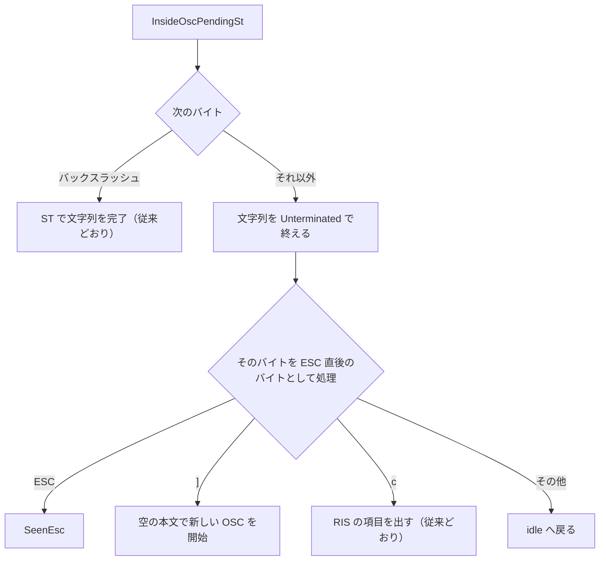

# mux-osc-double-esc-abort - 要件定義書

## 1. 概要

### 1.1 背景

mux ペインのデーモン取り込み（`AgentStatusFeedScanner::step`）は、OSC 本文の途中で ESC を受けた状態（`InsideOscPendingSt`）でもう一度 ESC を受けても、何もせず状態を保つ（`src-tauri/src/mux/ipc/pty_spawn/write_filter.rs:1556` の `0x1b => {}`）。そのため `ESC ] 07501;state=clear ESC ESC \` の末尾の `\` で、ST 終端の報告として取り込み、記録を削除する。

通常タブの term_core（`osc_escape`、`crates/term_core/src/parser/osc.rs:63`）は、ESC の直後が `\` でなければ文字列を Unterminated として打ち切り、その ESC を新しいエスケープの開始として扱う。OSC 7501 では、終端の無い報告を適用しない。

結果として、同じバイト列で通常タブと mux ペインの記録表が食い違い、osc7501-leading-zero-length SPEC の FR4 に反する。正規の綴り `ESC ] 7501;... ESC ESC \` でも以前から同じずれがあり、osc7501-leading-zero-length の変更で先頭ゼロ付きの綴りにも広がった。em-workflow osc7501-leading-zero-length の review round 1 で medium として残った指摘（stable_id `f058cb65aba2c3a1`）が出発点。

### 1.2 目的

`\` 以外のバイトが続く ESC で打ち切られた OSC 文字列について、同じバイト列に対する通常タブと mux ペインの状態をそろえる。比べる状態は、OSC 7501 の記録表、OSC 777 のエージェント状態、OSC 133 D→A の推定クリア（osc7501-leading-zero-length FR4）の 3 つ。

### 1.3 スコープ

- 対象
    - mux デーモンの `AgentStatusFeedScanner` で、`InsideOscPendingSt` の次に来るバイトの処理（OSC 7501 / OSC 777 agent-status / OSC 133）
    - 回帰を検出するテスト（スキャナ単体、および通常タブと mux ペインの一致テスト）
- 対象外
    - term_core（通常タブ）の変更（A2、NFR5）
    - 文字集合指示子スロットの追跡、DCS/APC 本文の追跡（A3）
    - 履歴除去（`osc_body_identity` / `client_parity_scan`）と scrollback 書き込みフィルタ（A4）

## 2. ビジネス要件

### 2.1 ビジネス目標

- 同じバイト列に対し、`\` が続かない ESC で OSC 文字列が打ち切られたとき、通常タブと mux ペインが同じ状態で終わる。比べる状態は OSC 7501 の記録表、OSC 777 のエージェント状態、OSC 133 D→A の推定クリア（osc7501-leading-zero-length FR4）。
- 再現手順の修正: `ESC]7501;state=working BEL` の後に `ESC]07501;state=clear ESC ESC \` を入力しても、通常タブと同じく mux ペインでも working の記録が残る。

### 2.2 対象ユーザー

| ユーザータイプ | 説明 |
|----------------|------|
| mux ペインの利用者 | 同じ出力に対して、通常タブと同じ記録表・エージェント状態を得る |

### 2.3 期待される効果

- 同じ入力に対し、通常タブと mux ペインで OSC 7501 の記録表、OSC 777 のエージェント状態、OSC 133 D→A の推定クリアの結果が一致する
- 再現手順で、mux ペインでも working の記録が残る

## 3. ユースケース

### 3.1 ユースケース一覧

| ID | ユースケース名 | アクター |
|----|----------------|----------|
| UC01 | 連続 ESC で打ち切られた OSC 7501 報告の取り込み | ペイン内で動くプログラム |

### 3.2 ユースケース詳細

#### UC01: 連続 ESC で打ち切られた OSC 7501 報告の取り込み

**アクター**: ペイン内で動くプログラム

**事前条件**:
- 通常タブと mux ペインのそれぞれで `ESC]7501;state=working BEL` が出力され、root=working の記録がある

**基本フロー**:
1. プログラムが `ESC]07501;state=clear ESC ESC \` を出力する
2. 通常タブの term_core は 2 つ目の ESC で文字列を Unterminated として打ち切り、報告を適用しない
3. mux デーモンの `AgentStatusFeedScanner` も 2 つ目の ESC で文字列を打ち切り、項目を出さない

**代替フロー**:
- 正規の綴り `ESC]7501;state=clear ESC ESC \` を出力する（AC2）
- 2 つの ESC の間で受信が分割される（AC3）

**事後条件**:
- 通常タブと mux ペインの両方で root=working が残る
- mux 側では、打ち切られた報告に対する broadcast も revision の変化も無い

## 4. 機能要件

### 4.1 機能一覧

| ID | 機能名 | 説明 |
|----|--------|------|
| FR1 | mux 取り込みの打ち切り規則 | `InsideOscPendingSt` の後、`\` 以外のバイトで OSC 文字列を Unterminated として終える |
| FR2 | 打ち切られた OSC 7501 文字列の破棄 | 打ち切られた OSC 7501 は項目を出さない |
| FR3 | 打ち切られた OSC 777 agent-status 文字列の適用 | 正規の接頭辞を持つ打ち切られた OSC 777 は Report を出す |
| FR4 | 打ち切られた OSC 133 文字列の適用（ライブ画面判定付き） | 打ち切られた OSC 133 は BEL / ST と同じ分類で、ライブのメイン画面のときだけ項目を出す |
| FR5 | 項目の順序 | 打ち切られた文字列の項目は、打ち切ったバイト以降の項目より前に出る |
| FR6 | 受信境界からの独立 | どこで分割して受信しても同じ項目になる |
| FR7 | 通常タブと mux の一致 | 同じ入力で通常タブと mux ペインの状態が一致する |
| FR8 | 変わらない挙動 | 既存の挙動と既存テストを維持し、term_core を変更しない |
| FR9 | 回帰テスト | スキャナ単体テストと、通常タブ / mux ペインの一致テストを追加する |

### 4.2 機能詳細

#### FR1: mux 取り込みの打ち切り規則

**説明**: mux デーモンの `AgentStatusFeedScanner` で、OSC 本文の途中の ESC の後（`InsideOscPendingSt`）に来たバイトを次のとおり処理する。

**ビジネスルール**:
- `\` は従来どおり ST として文字列を完了する
- それ以外のバイトは、OSC の種類によらず、組み立て中の OSC 文字列を Unterminated として終える
- そのバイトは続けて、ESC の直後のバイトとして処理する
    - ESC: 次のエスケープバイトを待つ（`SeenEsc`）
    - `]`: 空の本文で新しい OSC を開始する
    - `c`: 従来どおり RIS の項目を出す
    - その他: idle に戻る

**処理フロー**:

#### FR2: 打ち切られた OSC 7501 文字列の破棄

**説明**: 共通の認識規則で OSC 7501 にあたる文字列（正規の `7501;`、先頭ゼロ付きの `07501;`、その他共通規則が認める綴り）が FR1 で終えられた場合、項目を出さない。

**ビジネスルール**:
- 記録を変更しない
- broadcast も revision の変化も起こさない
- 照会への応答も返さない
- 通常タブの挙動（`callbacks.rs:1459-1463`）と一致する

#### FR3: 打ち切られた OSC 777 agent-status 文字列の適用

**説明**: 本文が正規の接頭辞 `777;emterm;agent-status;` で始まる OSC 文字列が FR1 で終えられた場合、BEL または ST で終わったときと同じ Report 項目を出す。

**ビジネスルール**:
- agent-status の取り込みは従来どおり正規の綴りのみ（osc7501-program-status FR18）
- それ以外の OSC 777 本文は、従来どおり項目を出さない

#### FR4: 打ち切られた OSC 133 文字列の適用（ライブ画面判定付き）

**説明**: FR1 で終えられた OSC 133 文字列は、BEL または ST と同じく `osc133_item` で分類する。

**ビジネスルール**:
- 正規のマークは `Osc133Mark` を出す。これは OSC 777 の D→A ラッチと OSC 7501 のプロンプト開始に渡る
- 共通規則で認めるプロンプト開始は `NonCanonicalPromptStart` を出す。これは OSC 7501 のプロンプト開始だけを適用する
- その他の種類は項目を出さない
- 項目は、文字列がライブのメイン画面上で終わったときだけ出す
- ライブかどうかは、文字列自身のバイトが終わった時点で載っていた画面で決める。打ち切ったバイトの位置では決めない
    - 例: `ESC]133;A ESC [?1049h` では、文字列を打ち切る ESC が代替画面への切り替えも始めるが、マークはメイン画面のものとして扱う

#### FR5: 項目の順序

**説明**: 打ち切られた文字列の項目は、打ち切ったバイトとそれ以降のバイトが出す項目より前に出る。

**ビジネスルール**:
- `ESC c` による Reset、`ESC ]` で開いた OSC の項目も、打ち切られた文字列の項目より後になる
- 項目は term_core がディスパッチする順序に従う

#### FR6: 受信境界からの独立

**説明**: ストリームを任意の 1 か所で分割した場合（2 つの ESC の間、ESC と打ち切るバイトの間を含む）、および 1 バイトずつ受信した場合も、出る項目は同じになる。

**ビジネスルール**:
- 打ち切りに必要な状態（FR4 のライブ判定など）は feed 呼び出しをまたいで引き継ぐ

#### FR7: 通常タブと mux の一致

**説明**: 同じ入力に対し、通常タブと mux ペインは同じ OSC 7501 の記録表と同じ OSC 777 のエージェント状態で終わる。正規の OSC 133 D→A の組については、推定クリアの結果も同じになる。

**ビジネスルール**: 対象の入力は次のとおり。
- `ESC ESC \` で打ち切られた OSC 7501 報告（`7501;` と `07501;` の両綴り、一括受信と 2 つの ESC の間での分割受信）
- `ESC ESC`、および ESC の後に別のバイトが来て打ち切られた OSC 777 agent-status 報告
- `ESC ESC`、および ESC の後に別のバイトが来て打ち切られた OSC 133 マーク（メイン画面と代替画面）

#### FR8: 変わらない挙動

**説明**: 次の挙動は従来どおりとする。

**ビジネスルール**:
- BEL と `ESC \` による確定
- 受信長 / 4096 バイトの規則
- 8 KiB の carry 上限
- 終端された OSC 133 マークのライブ区間判定
- RIS の追跡（`step_ris`）
- OSC 777 agent-status の正規綴りのみの取り込み
- 既存のすべてのテスト
- term_core は変更しない

#### FR9: 回帰テスト

**説明**: 回帰を検出するテストを追加する。

**ビジネスルール**:
- FR1〜FR6 のスキャナ単体テスト
- FR7 の通常タブ / mux ペイン一致テスト。実際の `pty_reader_loop` とデーモンタスクを通す
- 一致テストには、`ESC ESC \` で打ち切られた `7501;` と `07501;` の報告、および 2 つの ESC の間で分割された受信を含める

## 5. 非機能要件

### 5.1 パフォーマンス要件

- NFR1（堅牢性）: 追加する状態は O(1)

### 5.2 セキュリティ要件

- NFR1（堅牢性）: どの入力でも panic しない。carry は `AGENT_STATUS_FEED_SCANNER_CARRY_OVER_CAP`（8 KiB）以内に収まる。破棄した本文はクリアする（`retained_len` 0）

### 5.3 可用性要件

- 該当なし

### 5.4 保守性要件

- NFR3（ログ）: 打ち切られた入力や却下された入力は、従来どおりログに出さない

### 5.5 互換性要件

- NFR2（フィーチャーゲート）: 変更は `--no-default-features` でビルドされる mux のコードにとどまり、CLI のみのビルドもコンパイルできる
- NFR4（プラットフォーム）: Linux と Windows
- NFR5: term_core は変更せず、7501 を埋め込まない

## 6. UI/UX要件

該当なし（UI の変更なし）。

## 7. データ要件

該当なし。

## 8. 外部連携

該当なし。

## 9. 制約条件

### 9.1 技術的制約

- term_core（通常タブ）を基準の挙動とし、変更しない（A2、NFR5）
- 変更は `--no-default-features` でビルドされる mux のコードにとどめる（NFR2）
- carry は `AGENT_STATUS_FEED_SCANNER_CARRY_OVER_CAP`（8 KiB）以内（NFR1）

### 9.2 ビジネス上の制約

- 該当なし

### 9.3 スケジュール制約

- 該当なし

### 9.4 宣言された変更集合

このフィーチャー固有のパスは手動で列挙せず、create-plan で `workflow.yaml` の各タスクの `files` から導出する（`references/phases/create-plan-phase.md`）。

**デフォルトメンバー**（SPEC作成者が明示的に除外しない限り、常に宣言に含まれる）:
- `feature-docs/mux-osc-double-esc-abort/**`
- `test-docs/mux-osc-double-esc-abort/**`

`feature-docs/mux-osc-double-esc-abort/**` に含まれるもの: `REQUIREMENTS.md`、`SPEC.md`、`IMPLEMENTATION.md`、`workflow.yaml`、`phase-state/`、`tasks/`、`reviews/roundN.yaml`、`VERIFICATION.md`、`retrospect.yaml`、およびデザインステップが生成するデザイン成果物。生成主体は各フェーズドキュメントおよび `references/phase-state.md` を参照（引用のみ、ルールは再掲しない）。

`test-docs/mux-osc-double-esc-abort/**` に含まれるもの: `{T}.tests.yaml`（パス形式: `test-docs/mux-osc-double-esc-abort/{T}.tests.yaml`）。生成主体は `implement-phase.md` を参照（引用のみ、ルールは再掲しない）。

**意味論**:
- デフォルトのメンバーは、SPEC作成者が明示的に除外しない限り宣言に含まれる。除外は意図的な絞り込みであり、記載漏れによる省略ではない。
- この宣言はスーパーセット（superset）の主張であり、実際の変更集合は宣言に含まれる（CONTAINED IN）必要がある。実際には生成されないパスが宣言されていても違反にはならない。implementタスクを1つも生成しないフィーチャーは `test-docs/mux-osc-double-esc-abort/` ディレクトリを生成しないが、宣言された `test-docs/mux-osc-double-esc-abort/**` は依然として正しい。

## 10. 想定される課題とリスク

### 10.1 技術的課題

| 課題 | 影響度 | 対応策 |
|------|--------|--------|
| スキャナは文字集合指示子スロットを追跡しない（`ac1_existing_osc_recognition_is_unchanged_after_a_designator_escape` で固定済み） | 低 | 本タスクの対象外として現状を維持（A3） |
| スキャナは DCS/APC 本文を追跡しない（tmux パススルー形式 `ESC P tmux; ESC ESC ] ... ESC ESC \ ESC \` を含む） | 低 | 本タスクの対象外として現状を維持（A3） |

### 10.2 ビジネスリスク

該当なし。

## 11. 成功基準

### 11.1 受け入れ基準

- [ ] AC1（FR1, FR2, FR7, 再現手順）: `ESC]7501;state=working BEL` の後、`ESC]07501;state=clear ESC ESC \` を入力しても、通常タブと mux ペイン（実際の `pty_reader_loop` とデーモンタスク）の両方で root=working が残る。mux 側では、打ち切られた報告に対する broadcast も revision の変化も無い。
- [ ] AC2（FR2, FR7）: 正規の綴り `ESC]7501;state=clear ESC ESC \` でも AC1 が成り立つ。
- [ ] AC3（FR6, FR7）: ストリームを 2 つの ESC の間で分割しても、AC1 と AC2 で両経路の記録表が同じになる。スキャナ単体では、任意の 1 か所での分割と 1 バイトずつの feed が同じ項目を出す。
- [ ] AC4（FR1, FR5）: `ESC]7501;state=error ESC ESC ]7501;state=clear BEL` は、両経路で clear を適用する。
- [ ] AC5（FR3, FR7）: `ESC]777;emterm;agent-status;v=1;state=working` を `ESC ESC \` で打ち切った場合と `ESC X`（X は `\` 以外）で打ち切った場合、スキャナは Report を 1 つ出す。mux ペインの OSC 777 エージェント状態は通常タブと同じ（working）になる。
- [ ] AC6（FR4, FR7）: `ESC]133;D` に続く `ESC]133;A` を、それぞれ `ESC ESC \` または `ESC X` で打ち切ると、メイン画面で `Osc133Mark` 項目を出す。OSC 777 の D→A 推定クリアと 7501 のプロンプト開始（working・blocked・idle は削除、done・error は残す）は両経路で同じ結果になる。同じように打ち切った `ESC]0133;A` は `NonCanonicalPromptStart` だけを出す。
- [ ] AC7（FR4）: 代替画面で打ち切られた OSC 133 は項目を出さない。`ESC]133;A ESC [?1049h` はメイン画面のマークを出す。どちらの結果も、受信をどこで分割しても成り立つ。
- [ ] AC8（FR5）: `ESC]777;emterm;agent-status;v=1;state=working ESC c` は Report、Reset の順に出す。`ESC]133;A ESC ]7501;state=error BEL` はマーク、7501 の項目の順に出す。
- [ ] AC9（FR8）: 既存の program_status_feed、デーモン leading_zero_length、通常タブ一致、RIS 一致のテストがすべて変更なしで通る。
- [ ] AC10（NFR2）: `cargo check --no-default-features` が成功する。

### 11.2 KPI

該当なし。

## 12. テストシナリオ

### 12.1 テスト観点

- [ ] TS1（FR1〜FR6）単体、`src-tauri/src/mux/ipc/pty_spawn/tests.rs` の program_status_feed: 7501・777・133 について `ESC ESC`、`ESC X`、`ESC ]`、`ESC c` による打ち切りの遷移、項目の順序、`ESC [?1049h` による打ち切りを含むライブ区間判定、すべての位置での分割と 1 バイトずつの feed、打ち切り後の `retained_len` を確かめる。
- [ ] TS2（FR7, AC1〜AC3）結合、mux: デーモン leading_zero_length の `drive()` と sc4 コーパスに、`ESC ESC \` で打ち切られた `7501;` と `07501;` の行を追加する。2 つの ESC の間での分割には、分割して返す reader を使う（`pty_spawn/tests.rs:1152` に `ScriptedReader` がある）。
- [ ] TS3（FR7, AC1〜AC3）結合、通常タブ: 同じストリームを `seeded_plain_tab` / `process_combined`（`output_pipeline.rs`）に、一括で、および 2 つの ESC の間で分けた 2 回の `process_combined` 呼び出しで流し、記録表を TS2 の結果と比べる。
- [ ] TS4（FR3, FR4, FR7, AC5〜AC7）OSC 777 agent-status と OSC 133 の打ち切られた文字列の一致: mux ペインの osc777 状態と記録を、通常タブの agent-status イベント、ラッチ結果、7501 の記録表と比べる。
- [ ] TS5（FR8, AC9, AC10）: src-tauri と term_core の `--lib` スイート全体と、`--no-default-features` のチェックを実行する。
- E2E: 既存の E2E テストは無く、実行コマンドも検出されていない。

## 13. 用語定義

| 用語 | 定義 |
|------|------|
| `AgentStatusFeedScanner` | mux デーモンで PTY 出力から OSC 7501 / OSC 777 / OSC 133 の項目を取り出すスキャナ |
| `InsideOscPendingSt` | OSC 本文の途中で ESC を受けた後の、スキャナの状態 |
| `SeenEsc` | ESC を受け、次のエスケープバイトを待つスキャナの状態 |
| ST | 文字列終端 `ESC \` |
| Unterminated | BEL / ST 以外で終えられた OSC 文字列の扱い |
| 打ち切り | `InsideOscPendingSt` の後に `\` 以外のバイトが来て、OSC 文字列が Unterminated として終わること |
| ライブのメイン画面 | 代替画面ではないメイン画面で、OSC 133 の項目を出す対象となる区間 |

## 14. 確認事項

### 14.1 確認済み事項

- [x] A1: タスク記述の末尾（integration ブランチを残したままの push と gh pr create、Codex への相談と Notion への議論の記録）は実行指示であり、要件ではない。前任 SPEC の A3 と同じ扱い。
- [x] A2: term_core（通常タブ）を基準の挙動とし、変更しない。修正は mux を通常タブにそろえるもので、前任の NFR2 が term_core に 7501 を持ち込まない。
- [x] A3: スキャナと term_core の既存の 2 つの差異は対象外とする。スキャナは文字集合指示子スロットを追跡しない（`ac1_existing_osc_recognition_is_unchanged_after_a_designator_escape` で固定済み）。また DCS/APC 本文も追跡しない（tmux パススルー形式 `ESC P tmux; ESC ESC ] ... ESC ESC \ ESC \` を含む）。どちらも既存の差異で、本タスクが指す `InsideOscPendingSt` の分岐とは別。
- [x] A4: 履歴除去（`osc_body_identity` / `client_parity_scan`）と scrollback 書き込みフィルタは変更しない。本タスクの対象は記録表。`write_filter.rs` の `scan_string` は、ESC の後に `\` 以外のバイトが来たとき既に Aborted を返す（`write_filter.rs:1103-1109`）。
- [x] A5（requirement.abort-scope）: 打ち切りの範囲は all_and_align_unterminated とする。term_core は ESC の後に `\` 以外のバイトが来ると Unterminated の文字列をディスパッチし（`osc.rs:68`）、その文字列でも OSC 777 と OSC 133 のコールバックを呼ぶ（`osc_handler.rs:202`、`:275`、`callbacks.rs:1375`）。そのため通常タブは打ち切られた 777 / 133 を適用し、Unterminated を捨てるのは OSC 7501 だけ（`callbacks.rs:1459`）。mux も term_core と同じく、打ち切られた 7501 は捨て、777 / 133 は適用する。batch の判断表による回答で、Codex が確認済み。
- [x] A6（requirement.abort-scope）: 打ち切られた OSC 133 のライブ判定は、文字列のバイトが終わった時点で載っていた画面で行う。term_core は打ち切ったバイトが効く前にディスパッチするため。打ち切る ESC が代替画面への切り替えを始める場合、`extract_main_buffer` はその ESC をライブ区間から外すので、打ち切ったバイトの位置ではライブ判定ができない（`write_filter.rs:1347-1369`）。

### 14.2 未確認・保留事項

なし。

## 15. 参考資料

- osc7501-leading-zero-length SPEC: `feature-docs/osc7501-leading-zero-length/SPEC.md`（FR4）
- osc7501-program-status SPEC: FR18
- `src-tauri/src/mux/ipc/pty_spawn/write_filter.rs:1556`、`:1610`
- `crates/term_core/src/parser/osc.rs:63`
