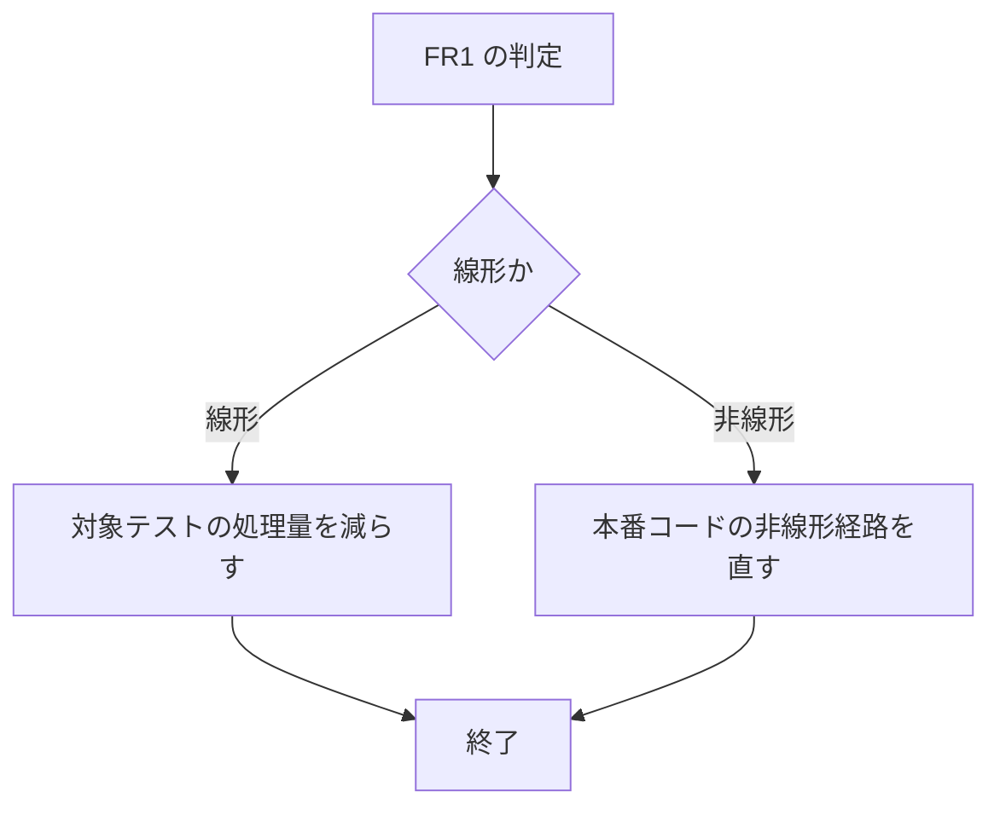

# mux-strip-concat-budget-overrun - 要件定義書

## 1. 概要

### 1.1 背景
mux の strip / write-filter テスト群にある `strip_concat_alternations_and_chains_finish_within_the_budget` は、debug ビルドで 10s の `BUDGET` 内に安定して収まっていない。本タスクはテスト側の不具合修正であり、UI・見た目・デザインシステムの変更を含まない。

### 1.2 目的
- `strip_concat_alternations_and_chains_finish_within_the_budget` が debug ビルドで安定して成功する。単独実行（`--test-threads=1`）でも、`mux::ipc::pty_spawn::tests` を直列実行したときでも成功する。
- テストはスレッド CPU 時間で予算を判定し、判定に CPU 負荷を必要としない。
- 処理量やコード経路が予算を超えて増えたとき、または非線形になったときに、テストが再発を検出する。

### 1.3 スコープ
- 対象テスト `strip_concat_alternations_and_chains_finish_within_the_budget` の計測・予算内化。
- スケーリング比による回帰ガードテストの追加。
- 次の並列実行時のみの失敗は対象外とし、別タスクで扱う（A2）。
    - `escape_state_carry::escape_carry_alternating_written_escapes_and_strip_targets_finish_within_the_budget`（壁時計 `Instant` 予算）
    - `post_strip_cut_csi::post_strip_alternating_strip_targets_and_open_csis_finish_within_the_budget`（壁時計 `Instant` 予算）
    - `strip_open_string_body_closure::open_body_closure_a_dcs_or_apc_body_left_open_by_an_overflow_flush_is_closed_at_the_next_removal`（壁時計 `Instant` 予算）
    - `visible_reattach_redelivers_alt_screen_and_main_screen_color_queries_once`（5s `recv_timeout`）

## 2. ビジネス要件

### 2.1 ビジネス目標
- 対象テストが debug ビルドで、単独実行でも `mux::ipc::pty_spawn::tests` の直列実行でも安定して成功する。
- 予算判定はスレッド CPU 時間で行い、CPU 負荷を必要としない。
- 処理量・コード経路の予算超過や非線形化をテストが検出する。

### 2.2 対象ユーザー
| ユーザータイプ | 説明 |
|----------------|------|
| 該当なし | テスト側の不具合修正のため、利用者向けの変更はない |

### 2.3 期待される効果
- 対象テストが debug ビルドで安定して成功する。
- 線形・非線形の回帰をスケーリング比テストが検出する。

## 3. ユースケース

### 3.1 ユースケース一覧
| ID | ユースケース名 | アクター | 優先度 |
|----|----------------|----------|--------|
| 該当なし | テスト側の不具合修正のため、ユースケースはない | - | - |

### 3.2 ユースケース詳細
該当なし。

## 4. 機能要件

### 4.1 機能一覧
| ID | 機能名 | 説明 | 優先度 |
|----|--------|------|--------|
| FR1 | 支配的なコストの特定 | 計測対象の入口ごと・ターゲットごと・形ごとにスレッド CPU 時間を計測し、線形・非線形を判定して記録する | 高 |
| FR2 | 対象テストを予算内に収める | FR1 の判定に応じて、処理量を減らす（線形）か本番コードの非線形経路を直す（非線形） | 高 |
| FR3 | スケーリング比による回帰ガード | N と 4N の CPU 時間比で線形・二次を判定するテストを追加する | 高 |

### 4.2 機能詳細

#### FR1: 支配的なコストの特定

**説明**: 計測対象の各入口のスレッド CPU 時間を、ターゲットごと・形（開いた CSI、単独 ESC）ごとに計測する。計測は対象テストのシングルスレッド実行だけで行い、`CpuMeter` を使う。同じ形で 2 種類の入力サイズを計測し、コストが線形か非線形かを判定する。内訳と判定をフィーチャードキュメントに記録する。この判定が FR2 の分岐を決める。

**計測対象の入口**:
- `strip_pty_output_for_scrollback_write`
- `strip_replayable_rich_content`
- `ScrollbackWriteFilter::feed`（1 回呼び出し / 単位揃え読み / 64 KiB 読み）
- ESC チェーンの呼び出し

**出力**:
- 入口ごと・形ごとの CPU 時間の内訳
- 線形 / 非線形の判定

#### FR2: 対象テストを予算内に収める

**説明**: FR1 の判定で分岐する。

**処理フロー**:

**ビジネスルール（線形の場合）**:
- 対象テストの処理量を減らし、計測合計が変更しない 10s の `BUDGET` に対して十分な余裕を持つようにする（AC-2）。
- 次をすべて維持する: `TARGETS` の全エントリ、両方の形、3 種の feed モード（1 回呼び出し / 単位揃え読み / 64 KiB 読み）、両方の strip 入口、ESC チェーン部分、すべての出力アサーション。
- すべてのターゲット × 形の 1 回呼び出し入力を `SCROLLBACK_FILTER_PENDING_CAP` より大きくし、overflow flush を通す。他の経路は同じ形の小さい入力を使ってよい。
- 共有の `TARGETS` / `Target` と共有の `BUDGET` は変更しない。

**ビジネスルール（非線形の場合）**:
- 本番コード（`strip_pass` / `ScrollbackWriteFilter`）の非線形経路を直す。
- 処理量は変更しない。
- 本番の出力はバイト単位で同一に保つ。

#### FR3: スケーリング比による回帰ガード

**説明**: 実際の `strip_pty_output_for_scrollback_write` と `ScrollbackWriteFilter::feed`（1 回呼び出し、cap 超え）を、同じ交互の形で N と 4N の入力で動かすテストを追加する。それぞれを `CpuMeter` で計測し、CPU 時間比で線形か二次かを判定する。

**ビジネスルール**:
- 比が 8 未満なら合格とする。8 は線形の 4 と二次の 16 の幾何平均である。
- N は、debug ビルドで各計測が約 100 ms 以上のスレッド CPU 時間になる値にする（Windows `GetThreadTimes` の分解能）。
- 比の判定そのものを、線形の代用処理と二次の代用処理で単体テストする（`thread_cpu_time.rs` の TS-4 と同じ方式）。

**バリデーション**:
| 項目 | ルール | エラーメッセージ |
|------|--------|------------------|
| N と 4N の CPU 時間比 | 8 未満 | - |

## 5. 非機能要件

### 5.1 パフォーマンス要件
- 予算はスレッド CPU 時間で `CpuMeter` を通して判定する。壁時計の予算は追加しない（NFR1）。
- 対象テストの計測合計は、開発機の debug シングルスレッド実行で `BUDGET` の半分（5s）以下（AC-2）。

### 5.2 セキュリティ要件
該当なし。

### 5.3 可用性要件
該当なし。

### 5.4 保守性要件
- 調査・実装・検証で意図的に CPU 負荷をかけない。負荷ループ、並列の負荷実行、大量の繰り返しを行わない。個々のテストのシングルスレッド実行だけを行う（NFR2）。
- strip と write filter の本番出力はバイト単位で同一に保つ。性能の変更は FR2 の非線形分岐の場合に限る（NFR3）。
- FR1 の内訳と判定をフィーチャードキュメントに記録する。

### 5.5 互換性要件
- Linux と Windows。テストは両方のクロック（`CLOCK_THREAD_CPUTIME_ID` / `GetThreadTimes`）でコンパイルでき、正しく判定する（NFR4）。

## 6. UI/UX要件

該当なし。

## 7. データ要件

該当なし。

## 8. 外部連携

該当なし。

## 9. 制約条件

### 9.1 技術的制約
- 共有の `TARGETS` / `Target`（`strip_open_string_body_closure.rs:41` からも import されている）と共有の `BUDGET`（`strip_concat_query.rs:907`、`1131`、`1170` でも使われている）は変更しない。処理量の削減は対象テスト自身の繰り返し回数と入力サイズだけで行う（A7）。
- CPU 時間の計測は `CpuMeter` のまま行う。`CpuMeter` はシングルスレッドで負荷に依存しない設計である（`thread_cpu_time.rs`）。新しいヘルパーを作る場合は、テストツリー内で `CpuMeter` の隣に置く（A9）。
- 対象テストの名前は変えない。そのため先行フィーチャーの test-docs 記録の改名更新は不要（`.claude/rules/test-docs-records.md`）（A8）。

### 9.2 ビジネス上の制約
- 並列実行時のみの失敗（1.3 に列挙）は対象外とし、別タスクで扱う（A2）。

### 9.3 スケジュール制約
- FR1 の判定が FR2 の分岐を決めるため、FR1 を FR2 より先に行う。

### 9.4 宣言された変更集合

このフィーチャー固有のパスは手動で列挙せず、create-plan で `workflow.yaml` の各タスクの `files` から導出する（`references/phases/create-plan-phase.md`）。

**デフォルトメンバー**（SPEC作成者が明示的に除外しない限り、常に宣言に含まれる）:
- `feature-docs/mux-strip-concat-budget-overrun/**`
- `test-docs/mux-strip-concat-budget-overrun/**`

`feature-docs/mux-strip-concat-budget-overrun/**` に含まれるもの: `REQUIREMENTS.md`、`SPEC.md`、`IMPLEMENTATION.md`、`workflow.yaml`、`phase-state/`、`tasks/`、`reviews/roundN.yaml`、`VERIFICATION.md`、`retrospect.yaml`、およびデザインステップが生成するデザイン成果物。生成主体は各フェーズドキュメントおよび `references/phase-state.md` を参照（引用のみ、ルールは再掲しない）。

`test-docs/mux-strip-concat-budget-overrun/**` に含まれるもの: `{T}.tests.yaml`（パス形式: `test-docs/mux-strip-concat-budget-overrun/{T}.tests.yaml`）。生成主体は `implement-phase.md` を参照（引用のみ、ルールは再掲しない）。

**意味論**:
- デフォルトのメンバーは、SPEC作成者が明示的に除外しない限り宣言に含まれる。除外は意図的な絞り込みであり、記載漏れによる省略ではない。
- この宣言はスーパーセット（superset）の主張であり、実際の変更集合は宣言に含まれる（CONTAINED IN）必要がある。実際には生成されないパスが宣言されていても違反にはならない。implementタスクを1つも生成しないフィーチャーは `test-docs/mux-strip-concat-budget-overrun/` ディレクトリを生成しないが、宣言された `test-docs/mux-strip-concat-budget-overrun/**` は依然として正しい。

## 10. 想定される課題とリスク

### 10.1 技術的課題
| 課題 | 影響度 | 対応策 |
|------|--------|--------|
| 「単独 ESC + csi query」の 1 回呼び出し入力が 500,000 バイトで、`SCROLLBACK_FILTER_PENDING_CAP`（524,288）を下回り、overflow flush を通っていない | 中 | FR2 で、すべてのターゲット × 形の 1 回呼び出し入力を cap より大きくする |
| Windows のクロック分解能が計測を支配する | 中 | FR3 の各計測を約 100 ms 以上の CPU 時間にする（A6） |
| 処理量の削減で、対象テストの doc comment が挙げる mux-strip-concat-query-closure AC-7 の 100k 規模から外れる（`strip_concat_query.rs:1010-1013`） | 低 | 本フィーチャーの SPEC にこの変更を記録し、テストの doc comment を新しいサイズに更新する（A8） |

### 10.2 ビジネスリスク
該当なし。

## 11. 成功基準

### 11.1 受け入れ基準
- [ ] AC-1: 再現コマンド `CARGO_TARGET_DIR=src-tauri/target cargo test --manifest-path src-tauri/Cargo.toml --lib strip_concat_alternations_and_chains_finish_within_the_budget -- --test-threads=1` が debug ビルドで成功する。（FR2）
- [ ] AC-2: 対象テストの計測合計が、開発機の debug シングルスレッド実行で `BUDGET` の半分（5s）以下である。`BUDGET` は 10s のまま。（FR2）
- [ ] AC-3: 対象テストが、8 個の `TARGETS` × 2 つの形について、2 つの strip と 3 つの feed モードで書き出し結果をアサートし、ESC チェーンについてもアサートする。すべてのターゲット × 形の 1 回呼び出し入力が `SCROLLBACK_FILTER_PENDING_CAP` より大きい。`TARGETS`、`Target`、`BUDGET` は変更されていない。（FR2）
- [ ] AC-4: FR1 の内訳（入口ごと・形ごと）と線形 / 非線形の判定がフィーチャードキュメントに記録されている。（FR1）
- [ ] AC-5: スケーリング比テストが実際の strip と write-filter の経路で成功する。比の判定は二次の代用処理を不合格にし、線形の代用処理を合格にする。（FR3）
- [ ] AC-6: `mux::ipc::pty_spawn::tests` を直列実行（`--test-threads=1`）すると、対象テストと新しいテストが成功する。（FR2、FR3）

### 11.2 KPI
| 指標 | 目標値 | 測定方法 |
|------|--------|----------|
| 対象テストの計測合計 | 5s 以下（`BUDGET` 10s の半分） | 開発機の debug シングルスレッド実行での判定メッセージ |
| N と 4N の CPU 時間比 | 8 未満 | `CpuMeter` によるスケーリング比テスト |

## 12. テストシナリオ

### 12.1 テスト観点
- [ ] 正常系: TS-1 再現コマンドをシングルスレッドで実行する。成功し、判定メッセージの合計が 5s 以下である。（AC-1、AC-2）
- [ ] 正常系: TS-2 対象テストの静的確認。`TARGETS` の全エントリと両方の形を回している。各 1 回呼び出し入力の長さが `SCROLLBACK_FILTER_PENDING_CAP` より大きい（テスト内でアサート）。単位揃え読みと 64 KiB 読みのループ、ESC チェーンのブロックがある。`TARGETS` / `Target` / `BUDGET` が main に対して変更されていない。（AC-3）
- [ ] パフォーマンス: TS-3 `strip_pty_output_for_scrollback_write` と `ScrollbackWriteFilter::feed` の N と 4N でのスケーリング比テスト。比が 8 未満。（AC-5）
- [ ] 異常系: TS-4 線形の代用処理（合格）と二次の代用処理（不合格）による比の判定。（AC-5）
- [ ] 正常系: TS-5 `mux::ipc::pty_spawn::tests` を `--test-threads=1` で実行する。対象テストと新しいテストが成功する。（AC-6）
- [ ] 正常系: TS-6 フィーチャードキュメントの確認。FR1 の内訳と判定がある。（AC-4）
- [ ] 境界値: すべてのターゲット × 形の 1 回呼び出し入力が `SCROLLBACK_FILTER_PENDING_CAP`（524,288）より大きい。（TS-2 に含む）

## 13. 用語定義

| 用語 | 定義 |
|------|------|
| 対象テスト | `strip_concat_alternations_and_chains_finish_within_the_budget` |
| `BUDGET` | 共有の予算値。10s |
| `CpuMeter` | スレッド CPU 時間を計測するテスト用の計測器（`thread_cpu_time.rs`）。シングルスレッドで負荷に依存しない設計 |
| `TARGETS` / `Target` | 共有のターゲット定義。`TARGETS` は 8 エントリ |
| `SCROLLBACK_FILTER_PENDING_CAP` | write filter の保留上限。524,288 バイト。これを超える 1 回呼び出し入力は overflow flush を通る |
| 形 | 入力の形。開いた CSI と単独 ESC の 2 つ |
| feed モード | `ScrollbackWriteFilter::feed` の呼び方。1 回呼び出し / 単位揃え読み / 64 KiB 読みの 3 つ |
| スケーリング比 | 同じ形の入力を N と 4N で計測したときの CPU 時間の比。線形なら 4、二次なら 16 |

## 14. 確認事項

### 14.1 確認済み事項
- [x] 修正方針（q-fix-approach）: investigate_then_branch（batch）。入口ごと・形ごとにシングルスレッドで計測する。線形なら処理量を減らしカバレッジを維持する。非線形なら本番コードを直し処理量を維持する。（A1）
- [x] 並列実行の扱い（q-parallel-scope）: target_only（batch）。1.3 に列挙した並列実行時のみの失敗は対象外とし、別タスクで扱う。（A2）
- [x] 回帰ガード（q-regression-guard）: both（batch）。スケーリング比テスト（FR3）と、十分な余裕を持たせた絶対値 10s の予算（AC-2）の両方を使う。（A3）
- [x] デザインステップ（q-design-step）: decide_autonomously（batch）。デザインステップは省略する。（A4）
- [x] 「十分な余裕」は、debug シングルスレッド実行での計測合計が `BUDGET` の半分（5s）以下を指す。（A5）
- [x] 比のしきい値は 8（N と 4N での線形 4 と二次 16 の幾何平均）。各計測は約 100 ms 以上の CPU 時間にする。（A6）
- [x] 共有の `TARGETS` / `Target` と共有の `BUDGET` は変更しない。処理量の削減は対象テスト自身の繰り返し回数と入力サイズだけで行う。（A7）
- [x] 対象テストの名前は変えない。処理量の変更が mux-strip-concat-query-closure AC-7 の 100k 規模から外れることを本フィーチャーの SPEC に記録し、テストの doc comment を新しいサイズに更新する。（A8）
- [x] CPU 時間の計測は `CpuMeter` のまま行う。新しいヘルパーはテストツリー内で `CpuMeter` の隣に置く。（A9）

### 14.2 未確認・保留事項
なし。

## 15. 参考資料

- `.claude/rules/test-docs-records.md`: test-docs 記録の改名更新ルール
- `thread_cpu_time.rs`: `CpuMeter` と TS-4 の比判定テスト
- `strip_concat_query.rs`: 対象テストと `BUDGET`
- `strip_open_string_body_closure.rs`: `TARGETS` / `Target` の import 元
- lib-budget-tests-load-tolerance: 対象テストの doc comment が挙げる、`CpuMeter` による計測の決定
