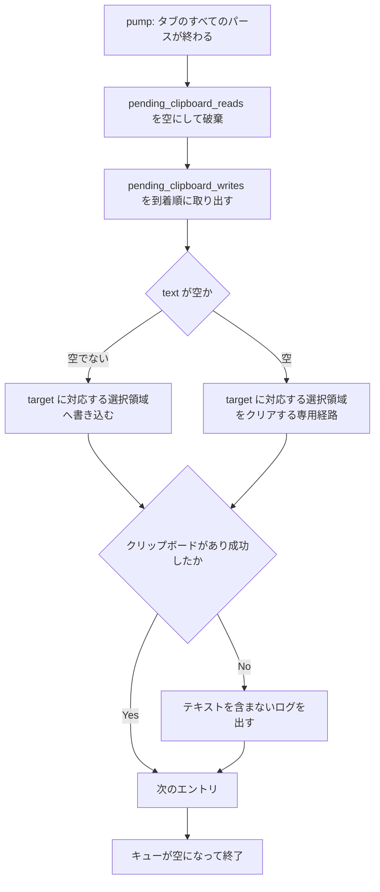
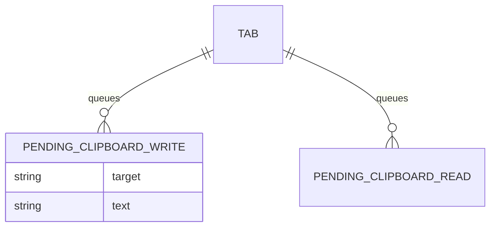

# osc52-clipboard-write-drain - 要件定義書

## 1. 概要

### 1.1 背景

SSH 越しに動く Claude Code のドラッグ選択による自動コピーは、OSC 52 でしかコピーできない。eMterm が受信した OSC 52 の書き込み（`ESC ] 52 ; <target> ; <base64> ST/BEL`）とクリア（空ペイロード）を、システムクリップボードへ届ける。

### 1.2 目的

- eMterm が受信した OSC 52 の書き込みがシステムクリップボードに届き、SSH 越しの Claude Code のドラッグ選択による自動コピーが実際にコピーされる
- OSC 52 のクリア（空ペイロード）がシステムクリップボードに届く
- OSC 52 コールバックのキュー（`pending_clipboard_writes`、`pending_clipboard_reads`）が際限なく伸びない
- キュー排出（drain）の退行をテストで検出できる

### 1.3 スコープ

**対象**:
- `pending_clipboard_writes` の書き込み・クリアを、target に対応するシステムの選択領域へ適用する
- `pending_clipboard_reads` を毎 pump 排出して破棄する
- 同じ pump 内のすべてのパース経路の後で排出する
- すべてのタブ（バックグラウンドタブ、mux 接続タブを含む）を排出する
- mux スナップショット再生に含まれる OSC 52 をクリップボードへ適用しない

**対象外**:
- OSC 52 読み取りへの応答（別フィーチャー）
- 非アクティブな mux ペインの出力に含まれる OSC 52（既存のペインルーティングで破棄される挙動を変えない）
- macOS

## 2. ビジネス要件

### 2.1 ビジネス目標

- SSH 越しの Claude Code のドラッグ選択による自動コピーが、eMterm 上で実際にコピーされる
- OSC 52 の書き込み・クリアがシステムクリップボードに届く
- OSC 52 のキューが際限なく伸びない
- 排出の退行がテストで検出される

### 2.2 対象ユーザー

| ユーザータイプ | 説明 |
|----------------|------|
| SSH 越しに Claude Code を使う開発者 | リモートで動く Claude Code のドラッグ選択で、OSC 52 経由のコピーを行う |
| OSC 52 を出力するプログラムを eMterm 上で使う開発者 | ローカルまたは SSH 越しのプログラムが OSC 52 の書き込み・クリアを出力する |

### 2.3 期待される効果

- OSC 52 の書き込み内容がシステムクリップボードから貼り付けられる
- OSC 52 のクリア後、対象の選択領域からテキストが貼り付けられない
- OSC 52 の書き込み・照会が続いてもキューが伸びない

## 3. ユースケース

### 3.1 ユースケース一覧

| ID | ユースケース名 | アクター |
|----|----------------|----------|
| UC01 | OSC 52 書き込みをクリップボードへ反映する | eMterm 上のプログラム（ローカルまたは SSH 越し）、ユーザー |
| UC02 | OSC 52 クリアをクリップボードへ反映する | eMterm 上のプログラム（ローカルまたは SSH 越し） |

### 3.2 ユースケース詳細

#### UC01: OSC 52 書き込みをクリップボードへ反映する

**アクター**: eMterm 上のプログラム、ユーザー

**事前条件**:
- eMterm のタブでプログラムが動いている（ローカルまたは SSH 越し）

**基本フロー**:
1. プログラムが OSC 52 の書き込み（例: `printf '\e]52;c;%s\a' "$(printf hello | base64)"`）を出力する
2. `NativeCallbacks::handle_clipboard` が受理し、`(target, text)` を `pending_clipboard_writes` に積む
3. 同じ pump 内で、そのタブのすべてのパースの後にキューを排出し、target に対応する選択領域へテキストを書き込む
4. ユーザーが貼り付けると、書き込まれたテキスト（例: `hello`）が得られる

**代替フロー**:
- base64 が不正、デコード後のサイズが `clipboard_max_size_osc52` を超える、または UTF-8 でない場合、キューに積まれずクリップボードに届かない（FR9）
- クリップボードを取得できない、または書き込みに失敗した場合、キューは排出され、パニックせず、テキストを含まないログを出す（FR8）
- mux スナップショット再生に含まれる OSC 52 はクリップボードへ適用されない（FR7）

**事後条件**:
- 書き込み先の選択領域が、その pump で最後に宛てられた書き込みのテキストを持つ
- `pending_clipboard_writes` と `pending_clipboard_reads` が空になっている

#### UC02: OSC 52 クリアをクリップボードへ反映する

**アクター**: eMterm 上のプログラム

**事前条件**:
- eMterm のタブでプログラムが動いている（ローカルまたは SSH 越し）

**基本フロー**:
1. プログラムが空ペイロードの OSC 52（例: `c;`、`p;`、`cp;`、`;`）を出力する
2. `Osc52Action::Clear` の分岐が、テキストが空のエントリを `pending_clipboard_writes` に積む
3. 同じ pump 内でキューを排出し、target に対応する選択領域をクリアする専用経路を通す

**代替フロー**:
- クリップボードを取得できない、またはクリアに失敗した場合、キューは排出され、パニックせず、テキストを含まないログを出す（FR8）

**事後条件**:
- クリアした選択領域からはテキストが貼り付けられない

## 4. 機能要件

### 4.1 機能一覧

| ID | 機能名 | 説明 | ステータス |
|----|--------|------|------------|
| FR1 | キュー済み OSC 52 書き込みのシステムクリップボードへの適用 | 空でないテキストの書き込みを、target に対応する選択領域へ到着順に書き込む | resolved |
| FR2 | キュー済み OSC 52 クリアの適用 | 空テキストのエントリで、target に対応する選択領域を専用経路でクリアする | resolved |
| FR3 | target から選択領域への対応付け | `c` / `p` / 両方 / それ以外を CLIPBOARD・PRIMARY へ対応付ける | resolved |
| FR4 | OSC 52 読み取りキューの排出と破棄 | `pending_clipboard_reads` を毎 pump 空にして破棄し、応答しない | resolved |
| FR5 | pump 内のすべてのパースの後に排出する | 同じ pump でタブの `NativeCallbacks` に届くすべてのパースの後で排出する | resolved |
| FR6 | すべてのタブを排出する | バックグラウンドタブ・mux 接続タブを含め、毎 pump すべてのタブを排出する | resolved |
| FR7 | スナップショット再生でクリップボードに書き込まない | mux スナップショット再生内容の OSC 52 を適用しない | resolved |
| FR8 | クリップボードが使えない場合 | 取得不可・失敗時もキューを排出し、パニックせず、テキストなしでログを出す | resolved |
| FR9 | 既存の受理ゲートを変えない | `handle_clipboard` の既存の拒否規則を維持する | resolved |

### 4.2 機能詳細

#### 排出処理の流れ（FR1〜FR4、FR8）

#### FR1: キュー済み OSC 52 書き込みのシステムクリップボードへの適用

**説明**: `NativeCallbacks::handle_clipboard` が `pending_clipboard_writes` に積んだ、テキストが空でない `(target, text)` の各エントリを、target が選ぶ選択領域（FR3）へ書き込む。書き込みは UI スレッドで、`WindowHost` が持つ arboard のクリップボードインスタンスを通して行う。

**入力**:
- target: 文字列 - OSC 52 の target パラメータ
- text: 文字列 - デコード済みのテキスト（空でない）

**出力**:
- target に対応する CLIPBOARD / PRIMARY の内容

**ビジネスルール**:
- エントリは到着順に適用する。1 回の pump の後、各書き込み先はそこへ宛てられた最後の書き込みのテキストを持つ

#### FR2: キュー済み OSC 52 クリアの適用

**説明**: テキストが空のエントリ（`Osc52Action::Clear` の分岐が積む）は、target が選ぶ選択領域（FR3）をクリアする。クリア後、その選択領域はテキストを持たない。

**入力**:
- target: 文字列 - OSC 52 の target パラメータ
- text: 空文字列

**出力**:
- target に対応する選択領域がテキストを持たない状態

**ビジネスルール**:
- クリアは専用経路で行う
- `WindowHost::set_clipboard` と `WindowHost::set_primary` は空テキストで早期 return する（`window_host/mod.rs:707`、`:733`）。既存の呼び出し元（コピー操作、マウスアップ時の PRIMARY コピー、`SelectionWriteSink`）向けにこの早期 return を維持する

#### FR3: target から選択領域への対応付け

**説明**: OSC 52 の target パラメータを次のように書き込み先へ対応付ける。

**ビジネスルール**:
- `c` を含む target は CLIPBOARD を選ぶ
- `p` を含む target は PRIMARY を選ぶ
- 両方を含む target は両方を選ぶ
- 空、または `s`・`0`〜`7`・`q` のみ（`c` も `p` も含まない）の target は CLIPBOARD を選ぶ
- Windows では PRIMARY を CLIPBOARD に置き換える。両方を選ぶ target は CLIPBOARD に 1 回書き込み、最終内容は同じになる
- クリア（FR2）も同じ対応付けを使う

#### FR4: OSC 52 読み取りキューの排出と破棄

**説明**: `pending_clipboard_reads` を毎 pump 空にし、エントリを破棄する。

**ビジネスルール**:
- クリップボードの内容を読まない
- PTY へ OSC 52 の応答を書かない
- 読み取りへの応答は別フィーチャーで扱う
- `handle_clipboard` の既存の `clipboard_read_osc52` ゲートと、その `LOG_OSC52_DENIED` ログはそのまま残す

#### FR5: pump 内のすべてのパースの後に排出する

**説明**: 各タブのクリップボードキューは、同じ pump でそのタブの `NativeCallbacks` に届きうるすべてのパースが終わった後で排出する。

**ビジネスルール**:
- 対象のパース経路:
  - mux 前の外側のパース
  - mux フレーム適用ループ（`apply_active_pane_output` / `flush_coalesced_output` によるアクティブペインの PtyOutput）
  - `Tab::process_combined` の Detached 後の末尾の再ルーティング
  - `App::pump_all` が `tab.pump()` の後に `tab.poll_pending_switch()` / `poll_pending_scrollback_restore()` で適用する、キュー済みのライブ出力
- これらのどの経路で届いた OSC 52 も、同じ pump で適用し、後の pump へ持ち越さない
- `process_combined` 内の早い段階の `cb_state` 排出ブロック（`output_pipeline.rs:345-401`）は、mux フレーム適用ループ（`:433-497`）と末尾の再ルーティング（`:543-548`）より前で動くため、この要件を満たさない
- `App::pump_all` の既存の `drain_osc` の位置（`app/mod.rs:1217`）は、これらすべての後にある

#### FR6: すべてのタブを排出する

**説明**: `drain_osc` がすでにすべてのタブを対象にしているのと同じく、バックグラウンドタブと mux 接続タブを含むすべてのタブのクリップボードキューを、毎 pump 排出して適用する。

#### FR7: スナップショット再生でクリップボードに書き込まない

**説明**: mux スナップショット再生の内容（同期の `reset_frame_for_replay` 経路、または off-thread 再生で適用される Snapshot / SnapshotRestore）に含まれる OSC 52 は、システムクリップボードへの書き込みもクリアも行わない。

**ビジネスルール**:
- ウィンドウ切り替えや再接続で、ユーザーの現在のクリップボードを過去の OSC 52 ペイロードで上書きしない

#### FR8: クリップボードが使えない場合

**説明**: arboard のクリップボードを取得できなかった場合（`WindowHost.clipboard` が `None`）、または書き込み・クリアの呼び出しが失敗した場合も、キューは毎 pump 排出する。

**エラーケース**:

| エラー | 条件 | 対応 |
|--------|------|------|
| クリップボード取得不可 | `WindowHost.clipboard` が `None` | キューを排出する。パニックしない。クリップボードのテキストを含まないログを出す |
| 書き込み・クリアの失敗 | set / clear の呼び出しが失敗する | キューを排出する。パニックしない。クリップボードのテキストを含まないログを出す |

#### FR9: 既存の受理ゲートを変えない

**説明**: `handle_clipboard` の既存の拒否規則の挙動を維持する。

**バリデーション**:

| 項目 | ルール | 対応 |
|------|--------|------|
| base64 | 不正な base64 | キューに積まない |
| デコード後のサイズ | `clipboard_max_size_osc52` を超える | キューに積まない。target と長さのみで `LOG_OSC52_DENIED` を出す |
| 文字コード | UTF-8 でない | キューに積まない |

キューに積まれないものはクリップボードに届かない。

## 5. 非機能要件

### 5.1 パフォーマンス要件

- **NFR1 キューの上限**: 各 pump の後、すべてのタブで `pending_clipboard_writes` と `pending_clipboard_reads` が空である。OSC 52 の書き込みや照会が続いても、際限なく伸びない

### 5.2 セキュリティ要件

- **NFR3 ログにクリップボード内容を含めない**: このフィーチャーで追加・変更するログ行は、デコード済みの OSC 52 テキストも base64 ペイロードも含まない。出してよいのは target、長さ、エラーの種類のみ
- 入力検証: FR9 の既存の受理ゲートを維持する

### 5.3 可用性要件

- FR8 のとおり、クリップボードが使えない場合もパニックしない

### 5.4 保守性要件

- **NFR4 フィーチャーゲート**: クリップボード適用のコードは `gui` フィーチャー内に置く。`CARGO_TARGET_DIR=src-tauri/target cargo check --manifest-path src-tauri/Cargo.toml --no-default-features` がコンパイルを通り続ける

### 5.5 互換性要件

- **NFR5 既存のコピー・貼り付けの挙動を変えない**: コピー操作（選択範囲での `set_clipboard`）、マウスアップ時の PRIMARY 自動コピー、`SelectionWriteSink::write_selection`、貼り付け（`get_clipboard` / `get_primary`）は現在の挙動を保つ
- **NFR6 プラットフォーム**: Linux（arboard 経由の X11 と Wayland）と Windows で成り立つ。macOS は対象外

### 5.6 スレッド要件

- **NFR2 UI スレッドからのクリップボードアクセス**: arboard は UI（イベントループ）スレッドからのみ、単一の `WindowHost` クリップボードインスタンスを通して呼ぶ。パース中に動くコールバックはキューに積むことだけを続ける

## 6. UI/UX要件

### 6.1 画面設計要件

該当なし（UI・表示の変更はない。デザインステップはスキップ）。

### 6.2 画面遷移

該当なし。

### 6.3 レスポンシブ対応

該当なし。

## 7. データ要件

### 7.1 データモデル概要

### 7.2 データ項目

| エンティティ | 項目名 | 型 | 必須 | 説明 |
|--------------|--------|-----|------|------|
| `pending_clipboard_writes` のエントリ | target | 文字列 | ○ | OSC 52 の target パラメータ |
| `pending_clipboard_writes` のエントリ | text | 文字列 | ○ | デコード済みテキスト。空ならクリア |
| `pending_clipboard_reads` のエントリ | — | — | — | 排出して破棄する |

`handle_clipboard` のキューへの積み方（`(target, text)` のタプル、クリアは空テキスト）は、既存テスト（`callbacks/tests.rs` の `osc_52_*` と ObservedState のパリティテスト `tests.rs:1000-1083`）で固定されている。

### 7.3 データ保持期間

| データ種別 | 保持期間 |
|------------|----------|
| `pending_clipboard_writes` | 各 pump の終わりまで（pump の後は空） |
| `pending_clipboard_reads` | 各 pump の終わりまで（pump の後は空） |

## 8. 外部連携

### 8.1 連携システム

| システム名 | 連携方法 | データ |
|------------|----------|--------|
| システムクリップボード（CLIPBOARD / PRIMARY） | `WindowHost` が持つ arboard のクリップボードインスタンス | OSC 52 の書き込みテキスト、クリア |

### 8.2 API仕様要件

該当なし。

## 9. 制約条件

### 9.1 技術的制約

- arboard は UI スレッドからのみ呼ぶ（NFR2）
- クリップボード適用のコードは `gui` フィーチャー内に置く（NFR4）
- `WindowHost::set_clipboard` / `WindowHost::set_primary` の空テキストでの早期 return を、既存の呼び出し元向けに維持する（FR2）
- `handle_clipboard` の既存の `clipboard_read_osc52` ゲートと `LOG_OSC52_DENIED` ログを残す（FR4）

### 9.2 ビジネス上の制約

- 対応プラットフォームは Linux と Windows。macOS は対象外（NFR6）

### 9.3 スケジュール制約

該当なし。

### 9.4 宣言された変更集合

このフィーチャー固有のパスは手動で列挙せず、create-plan で `workflow.yaml` の各タスクの `files` から導出する（`references/phases/create-plan-phase.md`）。

**デフォルトメンバー**（SPEC作成者が明示的に除外しない限り、常に宣言に含まれる）:
- `feature-docs/osc52-clipboard-write-drain/**`
- `test-docs/osc52-clipboard-write-drain/**`

`feature-docs/osc52-clipboard-write-drain/**` に含まれるもの: `REQUIREMENTS.md`、`SPEC.md`、`IMPLEMENTATION.md`、`workflow.yaml`、`phase-state/`、`tasks/`、`reviews/roundN.yaml`、`VERIFICATION.md`、`retrospect.yaml`、およびデザインステップが生成するデザイン成果物。生成主体は各フェーズドキュメントおよび `references/phase-state.md` を参照（引用のみ、ルールは再掲しない）。

`test-docs/osc52-clipboard-write-drain/**` に含まれるもの: `{T}.tests.yaml`（パス形式: `test-docs/osc52-clipboard-write-drain/{T}.tests.yaml`）。生成主体は `implement-phase.md` を参照（引用のみ、ルールは再掲しない）。

**意味論**:
- デフォルトのメンバーは、SPEC作成者が明示的に除外しない限り宣言に含まれる。除外は意図的な絞り込みであり、記載漏れによる省略ではない。
- この宣言はスーパーセット（superset）の主張であり、実際の変更集合は宣言に含まれる（CONTAINED IN）必要がある。実際には生成されないパスが宣言されていても違反にはならない。implementタスクを1つも生成しないフィーチャーは `test-docs/osc52-clipboard-write-drain/` ディレクトリを生成しないが、宣言された `test-docs/osc52-clipboard-write-drain/**` は依然として正しい。

## 10. 想定される課題とリスク

### 10.1 技術的課題

| 課題 | 対応策 |
|------|--------|
| daemon 側のスナップショット strip が、スナップショット内容から OSC 52 をすでに除去しているかは未検証（供給された調査対象の外にある） | FR7 がどちらの場合も求める挙動を定める。追加のガードが要るかは planner が判断する |
| 非アクティブな mux ペインの出力は既存のペインルーティング（`mux_link.rs:265-281`）で破棄され、その OSC 52 は失われる | 挙動は変えない。対象外 |

### 10.2 ビジネスリスク

該当なし。

## 11. 成功基準

### 11.1 受け入れ基準

- [ ] AC-1（FR1、FR3）: eMterm のタブ（ローカルまたは SSH 越し）で `printf '\e]52;c;%s\a' "$(printf hello | base64)"` を実行した後、CLIPBOARD を貼り付けると `hello` が得られる
- [ ] AC-2（FR1、FR3）: 代替のクリップボード sink で、キュー済みの書き込みが次のとおり振り分けられる。target `c` は CLIPBOARD、`p` は PRIMARY、`cp`（または `pc`）は両方、`''`・`s`・`0`・`7`・`q`・`s0` は CLIPBOARD。Windows では PRIMARY の書き込み先はすべて CLIPBOARD になる
- [ ] AC-3（FR2、FR3）: キュー済みのクリア（`c;`、`p;`、`cp;`、`;`）が、対応する書き込み先のクリア経路に届き、空テキストの早期 return で落とされない。選択範囲が空に解決されたコピー操作は、引き続き何も書き込まない
- [ ] AC-4（FR4、NFR1）: OSC 52 の書き込みと照会を受けた pump の後、両方のキューが空で、照会への応答として PTY に書かれたバイトがない
- [ ] AC-5（FR5、FR6）: アクティブペインの mux PtyOutput フレーム内の OSC 52 書き込みと、同じ coalesce 済みバッファの Detached 後の末尾にある OSC 52 書き込みが、パースされたのと同じ pump でクリップボード sink に届く
- [ ] AC-6（FR7）: OSC 52 の書き込みまたはクリアを含む Snapshot / SnapshotRestore を適用しても、クリップボードへの書き込みもクリアも起きない
- [ ] AC-7（FR8）: クリップボードが使えない状態で、OSC 52 の書き込みとクリアを含む pump がパニックせずに終わり、両方のキューが空になる
- [ ] AC-8（FR9）: 既存の callbacks テスト `osc_52_write_denied_when_over_quota`、`osc_52_query_denied_when_read_disabled`、`osc_52_write_default_allows_within_quota`、`osc_52_clear_pushes_empty_write`、`parse_osc52_*` が引き続き通る
- [ ] AC-9（NFR4）: `--no-default-features` の cargo check が成功する
- [ ] AC-10（FR1、FR6）: 排出を取り除くか、mux フレーム適用ループより前に置くと失敗するテストがある（タスクの完了条件が求める退行検出）

### 11.2 KPI

該当なし。

## 12. テストシナリオ

### 12.1 テスト観点

- [ ] 正常系: target ごとの書き込み先の振り分け（AC-2）、到着順の適用で最後の書き込みが残る（AC-2）、各パース経路で届いた OSC 52 が同じ pump で適用される（AC-5）
- [ ] 異常系: クリップボードが使えない状態でパニックしない（AC-7）、既存の受理ゲートで拒否される入力がクリップボードに届かない（AC-8）
- [ ] 境界値: 空の target、`c`/`p` を含まない target（AC-2）、空ペイロードのクリア（AC-3）
- [ ] セキュリティ: スナップショット再生の OSC 52 がクリップボードを上書きしない（AC-6）、読み取りに応答しない（AC-4）
- [ ] パフォーマンス: pump の後に両キューが空になる（AC-4）

テストシナリオの一覧と ID は SPEC.md を参照。

## 13. 用語定義

| 用語 | 定義 |
|------|------|
| OSC 52 | `ESC ] 52 ; <target> ; <base64> ST/BEL` 形式のクリップボード操作シーケンス。空ペイロードはクリア |
| target | OSC 52 の第 1 パラメータ。書き込み先の選択領域を指定する |
| CLIPBOARD | システムのクリップボード選択領域 |
| PRIMARY | システムのプライマリ選択領域。Windows では CLIPBOARD に置き換える |
| pump | `App::pump_all` による 1 回の処理サイクル |
| 排出（drain） | キューのエントリをすべて取り出し、キューを空にすること |

## 14. 確認事項

### 14.1 確認済み事項

- [x] target の対応付け（`osc52.target-mapping`）: `c_and_p_split`。`c` は CLIPBOARD、`p` は PRIMARY、両方あれば両方。空・`s`・`0`〜`7`・`q` のみは CLIPBOARD。Windows では PRIMARY を CLIPBOARD に置き換える。クリアも同じ対応付けを使う（A1）
- [x] 読み取りキューの扱い（`osc52.read-queue-handling`）: `drain_discard`。読み取りは毎 pump 排出し、応答しない。読み取りへの応答は別フィーチャー（A2）
- [x] デザインステップ（`design-step.decision`）: スキップ。UI・表示の変更はなく、コールバックキューをシステムクリップボードへ排出するだけである
- [x] 確認済みの事実: アクティブペインの mux PtyOutput 内の OSC 52 は、`handle_pty_output` → `apply_active_pane_output` → `core.process_pty_data_fully`（`mux_link.rs:399`、`output_pipeline.rs:260-283`）を通って `NativeCallbacks` に届く。タブの core が `NativeCallbacks` を持つため（`tabs/mod.rs:756-764`）。非アクティブな mux ペインの出力は既存のペインルーティング（`mux_link.rs:265-281`）で破棄され、その OSC 52 は失われる。この挙動は変えず、対象外。off-thread 切り替えの保留中にキューに入った出力は、swap の後に `App::pump_all` から適用される（`mux_link.rs:283-290` のコメント、`app/mod.rs:1177`）（A6）
- [x] 既存テストで固定済み: `handle_clipboard` のキューへの積み方（`(target, text)` のタプル、クリアは空テキスト）は、`callbacks/tests.rs` の `osc_52_*` と ObservedState のパリティテスト（`tests.rs:1000-1083`）で固定されている（A9）

### 14.2 未確認・保留事項

- [ ] daemon 側のスナップショット strip が、スナップショット内容から OSC 52 をすでに除去しているか（供給された調査対象の外にあるため未検証）。FR7 がどちらの場合も求める挙動を定め、追加のガードが要るかは planner が判断する（A7）

### 14.3 前提

- target のうち、回答で名指しされた文字以外（例: `x`）はどの書き込み先も選ばず無視する。`c` も `p` もない場合、書き込み先は CLIPBOARD（A3）
- バックグラウンドタブの OSC 52 書き込みも適用する（すべてのタブを排出する `drain_osc` と同じ）（A4）
- 1 回の pump 内の複数の書き込みは到着順（タブ順、その中でキュー順）に適用する。書き込み先ごとに最後の書き込みへまとめても、観測される結果は同じ（A5）
- クリア後、クリアした選択領域からはテキストが貼り付けられない。arboard の具体的な呼び出し（clear か、空テキストの設定か）は実装の選択とする（A8）

## 15. 参考資料

- SPEC.md: `feature-docs/osc52-clipboard-write-drain/SPEC.md`
