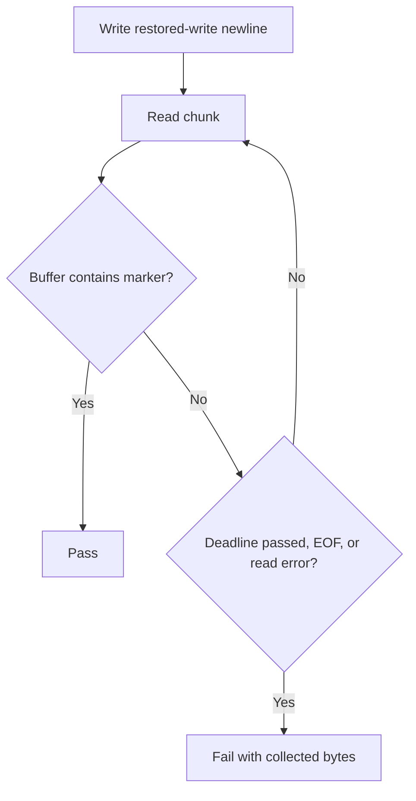

# restored-pane-read-flake-fix - Requirements

## 1. Overview

### 1.1 Background

`mux::session::pane::tests::from_restored_pane_can_write_and_read_through_its_adopted_master`
fails intermittently when the first PTY echo read returns only a prefix of the
echo. It fails in 13.5 % of unmodified full `--lib` runs, and in 18.7 % of runs
when run alone under full CPU load.

### 1.2 Purpose

- Stop the target test from failing intermittently when the first PTY echo read
  returns only a prefix, so that full `--lib` results can be read again.
- When the target test does fail, its message shows the bytes it read.

### 1.3 Scope

- The read-back part of the target test in `src-tauri/src/mux/session/pane/tests.rs`.
- A regression test that makes a prefix-only first read happen deterministically.
- The comment in `src-tauri/src/mux/upgrade/tests.rs` (lines 295-299) that calls
  the read deterministic.

Out of scope:

- Production code paths (`MuxPane::from_restored`, `write_input`, `pane/handles.rs`).
- Other known intermittent `--lib` failures
  (`mux::inherited_pty::tests::dropping_the_adapter_closes_the_owned_descriptor`,
  `mux::ipc::pty_spawn::tests::visible_reattach_redelivers_alt_screen_and_main_screen_color_queries_once`)
  and the `inherited_pty.rs` single-read tests (investigation follow-up
  candidates 2 and 3).
- `feature-docs/restored-pane-read-flake-investigation/INVESTIGATION.md`.

## 2. Business Requirements

### 2.1 Business Goals

- The target test no longer fails when the first PTY echo read returns only a
  prefix (13.5 % of unmodified full `--lib` runs, 18.7 % alone under full CPU
  load), so that full `--lib` results can be read again.
- When the target test fails, its message shows the bytes it read.

### 2.2 Target Users

| User type | Description |
|-----------|-------------|
| Developer | Runs the full `--lib` suite and reads its results |

### 2.3 Expected Effects

- The target test passes in full `--lib` runs when the echo arrives in pieces.
- A failure of the target test shows the bytes collected so far.

## 3. Use Cases

### 3.1 Use Case List

| ID | Use case | Actor | Priority |
|----|----------|-------|----------|
| UC01 | Run the full `--lib` suite | Developer | High |
| UC02 | Read the failure message of the target test | Developer | Medium |

### 3.2 Use Case Details

#### UC01: Run the full `--lib` suite

**Actor**: Developer

**Preconditions**:
- The crate builds with `CARGO_TARGET_DIR=src-tauri/target`.

**Basic flow**:
1. The developer runs `CARGO_TARGET_DIR=src-tauri/target cargo test --manifest-path src-tauri/Cargo.toml --lib`.
2. The target test writes `restored-write\n` through the restored pane.
3. The target test reads from the cloned master reader until the marker
   `restored-write` arrives or the deadline passes.

**Alternative flows**:
- The first read returns only a prefix (1-13 bytes), or the echo arrives in more
  than two pieces: the test keeps reading and passes once the marker is complete
  before the deadline.

**Postconditions**:
- The target test passes.

#### UC02: Read the failure message of the target test

**Actor**: Developer

**Preconditions**:
- The marker does not arrive (deadline passes, EOF, or read error).

**Basic flow**:
1. The target test fails.
2. The failure message contains every byte collected so far, in a readable
   escaped form.

**Postconditions**:
- The developer can see what the test read.

## 4. Functional Requirements

### 4.1 Function List

| ID | Function | Description | Priority |
|----|----------|-------------|----------|
| FR1 | Read until the marker arrives or a deadline passes | Accumulate echo chunks until the marker `restored-write` is present or the deadline passes | High |
| FR2 | Bounded wait on a blocking reader | Enforce the deadline on the blocking master reader with `poll` or a helper thread plus channel receive timeout | High |
| FR3 | Show the bytes read when the test fails | The failure message contains every byte collected so far | High |
| FR4 | Test that catches the bug coming back | A deterministic prefix-only first read proves the read-back logic still finds the marker | High |
| FR5 | Correct the comment that calls the read deterministic | Reword the comment in `src-tauri/src/mux/upgrade/tests.rs` (lines 295-299) | Medium |

### 4.2 Function Details

#### FR1: Read until the marker arrives or a deadline passes

**Description**: After writing `restored-write\n` through the restored pane, the
test keeps reading from the cloned master reader and appends each chunk to a
buffer. It stops when the buffer contains the marker `restored-write` or when a
bounded deadline passes.

**Input**:
- Echo chunks: bytes - read from the cloned master reader.

**Output**:
- Buffer: bytes - every chunk collected so far.

**Processing flow**:

**Business rules**:
- A first read that returns only a prefix of the echo (1-13 bytes) does not fail
  the test as long as the marker is complete before the deadline.
- An echo that arrives in more than two pieces does not fail the test as long as
  the marker is complete before the deadline.

#### FR2: Bounded wait on a blocking reader

**Description**: The wait for the echo has a deadline even though the cloned
master reader is a blocking fd with no timeout. The deadline is enforced with
`poll` on the master fd or with a helper thread that does the reads and hands
chunks back through a channel with a receive timeout. The test never blocks
without a bound.

#### FR3: Show the bytes read when the test fails

**Description**: When the deadline passes without the marker, when the reader
returns `Ok(0)` (EOF), or when the read returns an error, the test fails. Its
message contains every byte collected so far, in a readable escaped form such as
`String::from_utf8_lossy(..)` with `{:?}`, and keeps the meaning of the current
message (bytes written through the adopted master's writer must be readable back
through the adopted master, echoed by the PTY line discipline).

**Error cases**:

| Error | Condition | Handling |
|-------|-----------|----------|
| Deadline | The deadline passes without the marker | Fail; message contains the collected bytes |
| EOF | The reader returns `Ok(0)` | Fail; message contains the collected bytes |
| Read error | The read returns an error | Fail; message contains the collected bytes |

#### FR4: Test that catches the bug coming back

**Description**: A test makes a prefix-only first read happen deterministically
and proves that the read-back logic from FR1/FR3 still finds the marker. One way:
feed it a scripted reader that returns `rest`, then `ored-write\r\n`. The test
fails against the old shape (one read, then assert).

#### FR5: Correct the comment that calls the read deterministic

**Description**: The comment in `src-tauri/src/mux/upgrade/tests.rs` (lines
295-299) says `from_restored_pane_can_write_and_read_through_its_adopted_master`
proves the read side "deterministically". It is reworded so it no longer claims a
deterministic single read and instead matches the bounded read-until-marker
check.

## 5. Non-Functional Requirements

### 5.1 Performance Requirements

- NFR4 (Bounded duration): The deadline is a few seconds (for example 5 s, as in
  `pty/mod.rs` `pty_round_trip_echo_hello` and the reproduction program's loop
  mode). A passing run ends as soon as the marker is found, without waiting for
  the deadline.

### 5.2 Security Requirements

Not applicable.

### 5.3 Availability Requirements

Not applicable.

### 5.4 Maintainability Requirements

- NFR1 (Test-only change): Only test code under `src-tauri/src/` (`#[cfg(test)]`
  modules and test files) and test comments change. Production code paths
  (`MuxPane::from_restored`, `write_input`, `pane/handles.rs`) stay unchanged.
- NFR2 (No new dependencies): The fix uses dependencies already available to the
  crate's tests: std, `libc` (unix target dependency), and `crossbeam-channel`.
  `Cargo.toml` and `Cargo.lock` stay unchanged.

### 5.5 Compatibility Requirements

- NFR3 (Platform gating kept): The target test stays `#[cfg(unix)]`. Any
  `poll`/fd code is unix-gated, so the Windows target still compiles.
  `CARGO_TARGET_DIR=src-tauri/target cargo check --manifest-path src-tauri/Cargo.toml --no-default-features`
  still compiles.

## 6. UI/UX Requirements

Not applicable. The design step is skipped: test-only fix with no user interface
or visual change.

## 7. Data Requirements

Not applicable.

## 8. External Integration

Not applicable.

## 9. Constraints

### 9.1 Technical Constraints

- The cloned master reader is a blocking fd with no timeout.
- The PTY keeps the kernel's default termios (ICANON, ECHO, ONLCR on), so the
  expected echo is `restored-write\r\n` and the 14-byte marker `restored-write`
  is a valid success condition.
- Only test code and test comments change (NFR1).
- No new dependencies (NFR2).
- The target test and any `poll`/fd code stay unix-gated (NFR3).

### 9.2 Business Constraints

None.

### 9.3 Schedule Constraints

None.

### 9.4 Declared Change Set

Feature-specific paths are not listed by hand here. They are derived at
create-plan from every task's `files` entries in `workflow.yaml`
(`references/phases/create-plan-phase.md`).

**Default members** (part of the declaration unless the SPEC author explicitly
removes them):
- `feature-docs/restored-pane-read-flake-fix/**`
- `test-docs/restored-pane-read-flake-fix/**`

`feature-docs/restored-pane-read-flake-fix/**` covers `REQUIREMENTS.md`,
`SPEC.md`, `IMPLEMENTATION.md`, `workflow.yaml`, `phase-state/`, `tasks/`,
`reviews/roundN.yaml`, `VERIFICATION.md`, `retrospect.yaml`, and any design
artifacts the design step produces. Their producers are the phase documents and
`references/phase-state.md` (cited only; their rules are not restated).

`test-docs/restored-pane-read-flake-fix/**` covers `{T}.tests.yaml` (path form:
`test-docs/restored-pane-read-flake-fix/{T}.tests.yaml`). Its producer is
`implement-phase.md` (cited only; its rules are not restated).

**Semantics**:
- The default members are part of the declaration unless the SPEC author
  explicitly removes them. Removal is a deliberate narrowing, not an omission.
- The declaration is a superset assertion: the actual change set must be
  CONTAINED IN the declared set. A declared path that is never produced is not a
  violation. A feature that produces no implement tasks generates no
  `test-docs/restored-pane-read-flake-fix/` directory, and the declared
  `test-docs/restored-pane-read-flake-fix/**` entry is still correct.

## 10. Expected Issues and Risks

### 10.1 Technical Issues

| Issue | Impact | Response |
|-------|--------|----------|
| The blocking master reader has no timeout | High | FR2: `poll` on the master fd or a helper thread plus channel receive timeout |

### 10.2 Business Risks

None.

## 11. Success Criteria

### 11.1 Acceptance Criteria

- [ ] AC-1 (FR1, FR2): The target test passes when the echo arrives in several
  chunks whose first chunk is shorter than the 14-byte marker.
- [ ] AC-2 (FR3): When the marker does not arrive (deadline, EOF, or read error),
  the failure message contains the collected bytes.
- [ ] AC-3 (FR4): A test exists that deterministically produces a prefix-only
  first read and passes only with the read-until-marker logic.
- [ ] AC-4 (FR1, FR2, NFR4): Running the original reproduction (target test
  alone, 150 runs, while busy-loop threads occupy every logical CPU; 28 of 150
  failed before the fix) gives 0 failures of the target test.
- [ ] AC-5 (FR1, NFR1): The full `--lib` suite
  (`CARGO_TARGET_DIR=src-tauri/target cargo test --manifest-path src-tauri/Cargo.toml --lib`)
  runs with the target test passing.
- [ ] AC-6 (FR5): The comment in `src-tauri/src/mux/upgrade/tests.rs` near the
  `after-restore` write no longer says the pane-level test proves the read side
  deterministically.
- [ ] AC-7 (NFR2, NFR3): `Cargo.toml` / `Cargo.lock` are unchanged and the
  `--no-default-features` check compiles.

### 11.2 KPI

| Metric | Target | Measurement |
|--------|--------|-------------|
| Target test failures under load | 0 of 150 | TS-4 (target test alone, `--exact`, 150 runs, busy-loop threads on every logical CPU) |

## 12. Test Scenarios

### 12.1 Test Perspectives

- [ ] Normal: TS-3 - the target test passes against a real PTY pair with the
  read-until-marker logic.
- [ ] Normal: TS-1 - a scripted reader returns a strict prefix of
  `restored-write\r\n`, then the rest (and a variant that splits into three or
  more pieces); the read-back logic returns success with the marker found.
- [ ] Error: TS-2 - a scripted reader never completes the marker (returns a
  prefix, then EOF / no more data); the read-back logic reports failure, and the
  failure text contains the collected bytes.
- [ ] Load: TS-4 - the target test alone 150 times (`--exact`) while busy-loop
  threads occupy every logical CPU; 0 failures.
- [ ] Suite: TS-5 - full `--lib` run with the target test passing;
  `--no-default-features` cargo check compiles; `git diff` shows no Cargo
  manifest/lock changes.
- [ ] Inspection: TS-6 - the reworded comment in `src-tauri/src/mux/upgrade/tests.rs`.

## 13. Glossary

| Term | Definition |
|------|------------|
| Target test | `mux::session::pane::tests::from_restored_pane_can_write_and_read_through_its_adopted_master` |
| Marker | The 14-byte string `restored-write` |
| Expected echo | `restored-write\r\n` |
| Prefix-only first read | A first read that returns only 1-13 bytes of the echo |
| Deadline | The bounded wait for the marker (NFR4) |

## 14. Confirmed Items

### 14.1 Confirmed

- [x] A1: The test function name
  `from_restored_pane_can_write_and_read_through_its_adopted_master` stays
  unchanged, so the test-docs-records rename rule does not apply and the
  `test-docs/` records that list it need no update.
- [x] A2: FR4's regression test may be a new unit test of a small test-only
  read-until-marker helper, driven by a scripted `Read` implementation (the
  `ScriptedReader` style in `src-tauri/src/pty/mod.rs` is a precedent). It sits
  next to the target test in `src-tauri/src/mux/session/pane/tests.rs`. The name
  and exact placement are left to planning.
- [x] A3: Choosing between `poll` on the master fd and a helper thread plus
  channel timeout for the deadline (FR2) is left to planning. Both meet the
  requirement.
- [x] A4: In AC-4, "every logical CPU" means one busy-loop thread per logical CPU
  on the verifying machine (24 in the investigation). The busy-loop load is
  test-time tooling run outside the repository and is not committed.
- [x] A5: AC-5 counts only the target test. Other known intermittent `--lib`
  failures (`mux::inherited_pty::tests::dropping_the_adapter_closes_the_owned_descriptor`,
  `mux::ipc::pty_spawn::tests::visible_reattach_redelivers_alt_screen_and_main_screen_color_queries_once`)
  and the `inherited_pty.rs` single-read tests (investigation follow-up
  candidates 2 and 3) are out of scope.
- [x] A6: `feature-docs/restored-pane-read-flake-investigation/INVESTIGATION.md`
  is a predecessor feature's record. It stays as written, including its quotation
  of the "deterministic" comment and its line numbers.
- [x] A7: The PTY keeps the kernel's default termios (ICANON, ECHO, ONLCR on), so
  the expected echo is `restored-write\r\n` and the 14-byte marker
  `restored-write` is a valid success condition. This is a preserved fact from
  the investigation.

### 14.2 Open Items

None.

## 15. References

- `feature-docs/restored-pane-read-flake-investigation/INVESTIGATION.md`: predecessor investigation record.
- `src-tauri/src/pty/mod.rs`: `ScriptedReader` and `pty_round_trip_echo_hello` (pattern references).
